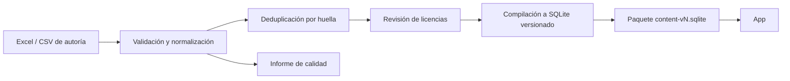

# CONTENT_DATABASE — Catálogo de contenido cultural (≥ 30.000 registros)

Convenciones en `README.md`. Condicionado por D-04 (legal), D-05 (imágenes) y D-14 (Excel). Léxico en `LEXICAL_DATABASE_AND_APIS.md`.

## 1. Objetivo y principios
- Un banco de **al menos 30.000 registros únicos** de estímulos culturales, separado del banco léxico.
- **Ampliable sin cambiar código:** se agregan filas/archivos y se recompila el paquete.
- **Respeto de derechos:** para obras protegidas solo **metadatos y enlace externo**; los fragmentos de texto solo si son de dominio público, licencia compatible, permiso expreso o **frases de la casa**.
- **Hasta contar con consulta legal (D-04)** no se incluyen citas de obras protegidas.
- Cada registro conserva procedencia y licencia.

## 2. Flujo de producción

- **Excel es solo fuente de autoría.** La app consume SQLite (D-14).
- Un script de la carpeta `/scripts` valida columnas obligatorias, tipos, licencias permitidas y duplicados; **falla la compilación** ante cualquier error.

## 3. Pools (tipos de registro)

| Pool | Usado por (Juegos) | Contenido permitido | Objetivo orientativo |
|---|---|---|---|
| `titles` | 2 Desde el Título | Títulos y frases cortas con autor; ver 5 | ~8.000 |
| `characters` | 5 En la Piel | Nombre, obra, breve descripción propia, enlace | ~3.000 |
| `songs` | 8, 9, 10 Canción Influencia | Título, artista, año, URL de búsqueda | ~6.000 |
| `poems_songs_ref` | 17 Frankenstein, 21 La Séptima | Nombre de obra y autor (metadatos) | ~3.000 |
| `quote_public` | 13 Cociendo Frases, 18 Verso Insistente | Fragmentos de dominio público/licencia compatible o de la casa | ~4.000 |
| `script_phrases` | 16 El Guion | Solo dominio público/de la casa/original (ver D-04) | según permisos |
| `prompts` | Fase 0 Prompt, 7, 4, 25 | Disparadores originales | ~1.500 |
| `images` | Fase 0 Prompt, 19 Collage | Catálogo con atribución (ver 6) | ~2.500 |
| `situations` / `restrictions` | 22 Restricciones | Escenarios y reglas | ~1.500 |
| `themes` / `universes` | 27 Traslado de universo | Temas y universos temáticos con vocabulario asociado | ~800 |
| `dice_*` | 24 Dados Líricos | Lugares, personajes, objetos, acciones, emociones, cualidades | ~3.000 |
| `sensory_questions` | 20 Sentidos Guía | Preguntas por sentido | ~500 |
| `cutup_texts` | 29 Cut-up | Textos de dominio público | ~300 |
| `portal_seeds` | 6 Palabra Portal | Palabras-lugar iniciales | ~300 |
| `confession_topics` | 26 Secreto y confesión | Temas | ~300 |
| `letter_triggers` | 25 Carta que nunca envié | Disparadores emocionales | ~300 |

Suma orientativa ≈ 35.000. La cifra real se confirma con el informe de calidad. **Los 30.000 no se alcanzan con contenido protegido: se alcanzan con metadatos, contenido original y dominio público.** Esto no se puede forzar sin riesgo legal.

## 4. Esquema de columnas (Excel/CSV) y tabla SQLite

Columnas comunes a todo pool:

| Columna | Obligatoria | Descripción |
|---|---|---|
| `pool` | Sí | Nombre del pool |
| `id` | Sí | `pool:hash8` (se genera al compilar si falta) |
| `text` | Según pool | Texto mostrable (título, frase, prompt…) |
| `author` | Según pool | Autor/artista/creador |
| `work` | No | Obra de procedencia |
| `year` | No | Año |
| `kind` | No | Subtipo (libro, película, serie, canción, poema…) |
| `lang` | Sí | `es`, `en`, etc. |
| `origin_license` | Sí | `public_domain`, `cc0`, `cc_by`, `cc_by_sa`, `original`, `metadata_only`, `permission` |
| `source_url` | Sí* | Fuente de verificación (*obligatoria salvo `original`) |
| `external_link` | No | Enlace para consultar la obra (búsqueda, Wikipedia…) |
| `attribution` | Si la licencia lo exige | Texto de atribución |
| `tags` | No | Etiquetas temáticas (para pares tipo «imágenes relacionadas») |
| `reviewed_by` / `reviewed_at` | Sí | Control humano |
| `status` | Sí | `draft`, `approved`, `retired` |

SQLite: tabla `content(id, pool, text, author, work, year, kind, lang, license, source_url, external_link, attribution, tags, fingerprint, version)` + índices por `pool`, `tags` y `fingerprint`.

### Reglas de campo por pool
- `songs`, `titles` (obra protegida): `text` = **título**, sin letra; `license = metadata_only`; `external_link` = **URL de búsqueda** (p. ej., de YouTube con «título artista»), **no IDs de video** (D-13).
- `characters`: la **descripción es redacción propia**; el enlace apunta a una fuente de consulta.
- `quote_public`: `license` debe ser `public_domain`, `cc*` compatible o `original`; texto con `source_url`.
- Ningún registro con `license = metadata_only` puede tener texto de la obra en `text` (la compilación lo valida contra un tope de longitud y una lista de excepciones).

## 5. Estrategia de abastecimiento (30.000 registros)

| Fuente candidata | Para qué | Condiciones |
|---|---|---|
| Wikidata / Wikipedia | Metadatos de libros, películas, series, personajes, obras | **[VERIFICAR]** licencia de cada dataset y atribución |
| Open Library | Libros y autores | **[VERIFICAR]** |
| MusicBrainz | Canciones y artistas (metadatos) | **[VERIFICAR]** licencia de datos |
| Proyecto Gutenberg, Wikisource, Biblioteca Virtual Miguel de Cervantes | Textos de dominio público | Verificar que la obra lo sea según la ley aplicable y la traducción/edición |
| Autoría propia | Prompts, restricciones, escenarios, dados, preguntas, frases de la casa | Sin restricciones; fuente principal de volumen |
| Material generado con modelos de IA como **ayuda de redacción** | Borradores de listas | **No** va a la app sin revisión humana y verificación de originalidad; marcar `origin = original` solo tras revisión |

Reglas:
1. Antes de cada importación se anota la licencia vigente y la fecha de consulta en `source_meta`.
2. Nada se incorpora «por si acaso»: si no se puede probar la licencia, queda `draft`.
3. El material con *ShareAlike* se compila en un paquete aparte para no contaminar el resto.

## 6. Imágenes (D-05: catálogo incluido + API)

**Dos orígenes:**
1. **Paquete incluido:** imágenes con licencia clara, redimensionadas y comprimidas (p. ej., ancho máximo 1080 px, formato eficiente), con `attribution` por imagen. Funciona offline.
2. **API gratuita complementaria** (a elegir): candidatos Openverse, Wikimedia Commons, Pexels, Unsplash, Pixabay **[VERIFICAR]** términos, límites de solicitudes, uso comercial, atribución y si permiten caché local. La app **no guarda** lo descargado más allá de la sesión (a menos que los términos lo permitan y se declare).

**Metadatos de imagen:** `id`, `source` (included|api:<proveedor>), `author`, `license`, `source_url`, `attribution`, `tags` (tema), `mood` (emociones), `palette` (colores dominantes), `orientation`, `nsfw=false` (filtro obligatorio).

**Necesidades de los Juegos:**
- *Prompt (Fase 0)* e *imagen* se sortean **independientemente**.
- *Canción Collage:* modo «tres aleatorias» y modo «relacionadas» (misma etiqueta temática o paleta/mood). Esa relación se resuelve con `tags`/`mood`, calculados en la compilación o curados.
- **Prohibido generar imágenes con IA.** Si una imagen de origen es generada por IA, se excluye.
- Filtros de seguridad: sin violencia gráfica, sin desnudos, sin menores identificables en primer plano [REC], sin marcas visibles de manera destacada.

## 7. Calidad y deduplicación
1. Huella normalizada (ver `RANDOMIZATION_SYSTEM.md`, sección 4) **global entre pools**: un mismo título no puede estar en dos pools.
2. Validación ortográfica y de codificación (NFC).
3. Informe por compilación: conteo por pool y licencia, duplicados, registros sin fuente, rechazados.
4. Muestra aleatoria de ≥ 200 registros revisada a mano antes de publicar un paquete.
5. Versionado: `content-v<N>.sqlite` + `manifest.json` con hash, tamaño y licencias.

## 8. Ampliación sin tocar código
- Nuevos registros → nueva versión del paquete.
- Nuevo pool → entrada en el manifiesto y en `registry` del Juego que lo use (cambio de datos y registro, no de la lógica común).
- Actualización opcional por descarga de manifiesto estático (ver `TECHNICAL_ARCHITECTURE.md`, sección 7).

## 9. Criterios de aceptación
1. La compilación falla si falta `origin_license`, `lang` o `source_url` (cuando corresponde).
2. No existen dos registros con igual huella en todo el paquete.
3. Ningún registro `metadata_only` contiene texto de la obra.
4. Cada imagen tiene autor y licencia.
5. El informe de calidad lista ≥ 30.000 registros aprobados, o declara el faltante por pool.
6. Pruebas en `QA_AND_ACCEPTANCE_TESTS.md` (tanda 5).

## 10. Preguntas abiertas
1. ¿Qué API de imágenes se elige y con qué límites? (verificar términos).
2. Resultado de la consulta legal: ¿qué se puede incluir de frases de guiones y citas?
3. ¿Quién redacta el volumen de contenido original (prompts, escenarios, dados)? Se propone trabajarlo en tandas guiadas, con revisión humana.
