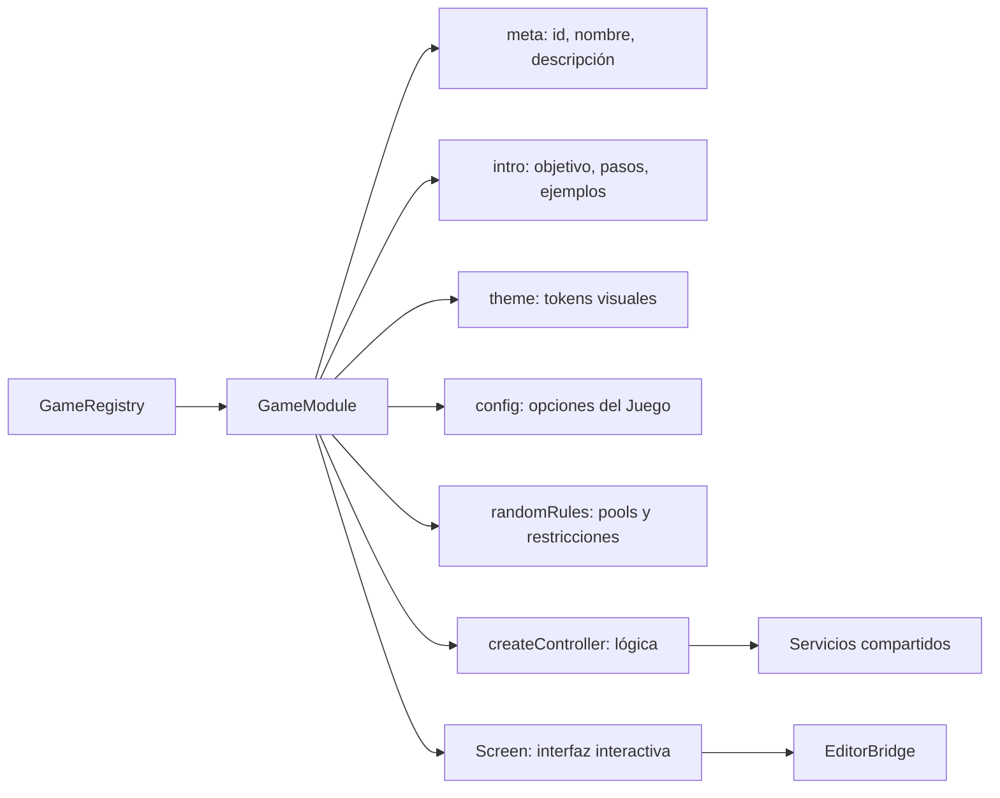
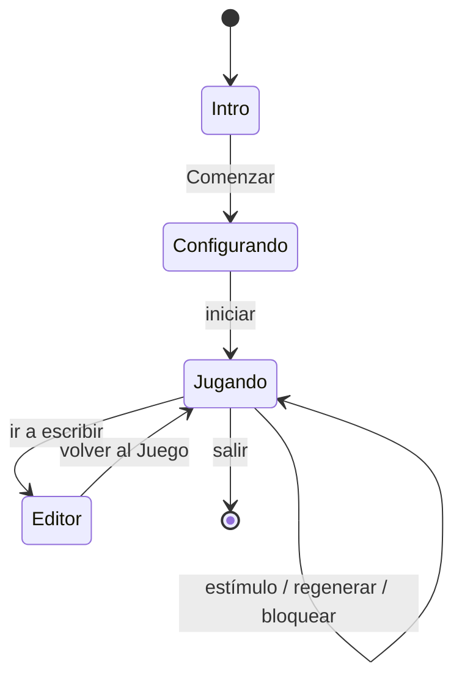

# GAME_ARCHITECTURE — Arquitectura modular de los Juegos

Convenciones en `README.md`. Capas generales en `TECHNICAL_ARCHITECTURE.md`. Catálogo en `GAME_CATALOG.md`.

## 1. Objetivos
1. Agregar un Juego = crear su carpeta y registrarlo, sin tocar navegación ni servicios.
2. Todos los Juegos usan el **mismo editor central** y los mismos servicios.
3. Cada Juego tiene identidad visual propia a través de un **tema** (datos), no de una interfaz copiada.
4. Los Juegos **nunca modifican destructivamente** la letra.

## 2. Anatomía de un Juego



## 3. Contrato `GameModule`

```ts
type GameId = `g${number}` ; // g01 ... g32

interface GameModule<State = unknown, Config = unknown> {
  id: GameId;
  order: number;                       // posición en el catálogo (1–32)
  name: string;                        // «Asociación Libre»
  tagline: string;
  description: string;                 // objetivo
  steps: string[];                     // cómo se juega, paso a paso
  examples: GameExample[];             // ejemplos suficientes
  theme: GameTheme;                    // ver DESIGN_SYSTEM.md
  defaultConfig: Config;
  randomRules: PoolRequirement[];      // pools que necesita
  dataNeeds: DataNeed[];               // lemas, contenido, imágenes
  needsNetwork: 'never' | 'optional';  // solo para abrir enlaces o imágenes API
  createController(ctx: GameContext): GameController<State, Config>;
  Screen: React.ComponentType<GameScreenProps>;
}
```

```ts
interface GameContext {
  random: RandomService;
  data: DataService;
  timer: TimerService;
  editor: EditorBridge;
  audio: AudioService;
  entitlement: EntitlementService;
  generator: GeneratorProvider;        // local en v1, IA futura
}

interface GameController<S, C> {
  getState(): S;
  start(config: C): Promise<void>;
  dispatch(action: GameAction): Promise<void>;
  serialize(): S;                      // solo para la sesión en memoria
  dispose(): void;
}
```

Regla: cada Juego define **intro**, **interfaz** y **controlador**. El controlador es lógica pura y testeable sin interfaz.

## 4. Flujo estándar de un Juego



- **Intro** (obligatoria, 5 elementos): título, objetivo, paso a paso, ejemplos, botón «Comenzar».
- **Configurar** (opcional según el Juego): categorías, cantidades, modalidad.
- **Jugar:** interfaz propia + **acceso permanente al editor** (panel inferior o pantalla dividida).
- Al salir y volver al mismo Juego dentro de la sesión, **se restaura su estado** (en memoria).

## 5. Editor Bridge (API entre Juegos y editor)

```ts
interface EditorBridge {
  open(opts?: { focusSectionId?: string }): void;      // abre el editor central
  getCursor(): { sectionId: string; stanzaId: string; line: number } | null;
  insertAtCursor(text: string, opts?: { asNewLine?: boolean }): void;  // solo por acción del usuario
  appendToSection(sectionId: string, text: string): void;
  setStimulusPanel(content: StimulusSummary): void;    // estímulos visibles junto al editor
  clearStimulusPanel(): void;
  getLyricsSnapshot(): LyricsSnapshot;                 // solo lectura (La Séptima, Cut-up)
}
```

Reglas:
1. Ningún método **reemplaza ni borra** texto del usuario. `insertAtCursor` solo se llama tras un gesto explícito («Llevar al editor»).
2. `getLyricsSnapshot` es de solo lectura. La Séptima lo usa para detectar versos y **sugerir** sustituciones.
3. `setStimulusPanel` mantiene visible el estímulo clave (palabra núcleo, verso insistente, cuatro palabras, etc.) mientras se escribe.

## 6. Servicios que usa cada Juego

| Servicio | Uso típico |
|---|---|
| `RandomService` | Todo sorteo; ver `RANDOMIZATION_SYSTEM.md` |
| `DataService` | Lemas, relaciones, rimas, paquetes de contenido |
| `TimerService` | Cuenta regresiva, cronómetro, opcional en Dados Líricos y Fase 0 |
| `AudioService` | Reproductor de acordes accesible desde cualquier Juego |
| `GeneratorProvider` | Estímulos y sugerencias (local en v1) |

## 7. Componentes compartidos de interfaz
`GameIntro`, `StimulusCard`, `SwipeableCard` (deslizar izq/der), `LockToggle`, `DiceButton`, `WordChip`, `ProgressRing`, `EditorDock`, `SourceTooltip`, `FullscreenImageViewer`, `TimerBadge`. Cada uno recibe el tema del Juego. Especificaciones visuales en `DESIGN_SYSTEM.md`.

## 8. Temas por Juego
`GameTheme` es un objeto de datos: paleta, tipografías (de una lista cerrada del sistema de diseño), fondo, patrón, animaciones de entrada, iconografía y *tokens* de espaciado. La mayoría de los Juegos reutilizan componentes con otro tema; los que necesitan lienzo propio (Mapa Mental, Cut-up, Collage textual, Cadena de letras, Dados, Collage de imágenes) agregan **un componente de escena específico**.

## 9. Registro (`registry.ts`)
```ts
export const games: GameModule[] = [g01, g02, ..., g32];  // orden fijo 1–32
export const byId = Object.fromEntries(games.map(g => [g.id, g]));
```
- La navegación y el dado de Juego leen del registro.
- Un test verifica: 32 Juegos, ids únicos, orden 1–32, cada uno con `steps`, `examples` y `theme`.

## 10. Reglas de calidad
1. Controladores sin dependencias de React ni del sistema operativo → pruebas unitarias.
2. Sin acceso directo a SQLite ni a `Math.random` desde el Juego.
3. Estados y acciones tipados; acciones nombradas en inglés, textos en es-AR.
4. Textos de intro y ejemplos en archivos de contenido (JSON), no incrustados en componentes.
5. Un Juego de más de ≈ 400 líneas por archivo se divide.

## 11. Agrupación de Juegos por tipo de escena (para planificar el desarrollo)

| Escena | Juegos | Observación |
|---|---|---|
| Tarjeta de estímulo único | 2, 8, 9, 10, 14, 18, 5, 12 | Simple; base de componentes |
| Varias tarjetas independientes | 13, 16, 17, 19 | Deslizar/reemplazar individual |
| Columnas/listas de palabras | 1, 3, 11, 24 | Regeneración, bloqueo |
| Entrada de usuario + estímulo | 4, 6, 7, 15, 22, 25, 26, 27, 32 | Formularios guiados |
| Lienzo interactivo | 23, 28, 29, 30, 31 | Mayor costo de desarrollo |
| Editor-integrado | 21 | Lee el editor |
| Guía por preguntas | 20 | Estructura fija de 7 dimensiones |

Esto se usa en `IMPLEMENTATION_ROADMAP.md` para ordenar la implementación: primero tarjetas, luego listas, luego lienzos.

## 12. Evolución futura
Un Juego futuro se agrega con: carpeta `games/gNN-...`, entrada en el registro, datos nuevos (paquete) y pruebas. No requiere cambios en navegación. La incorporación de IA se hace implementando `GeneratorProvider` remoto sin tocar los controladores.
