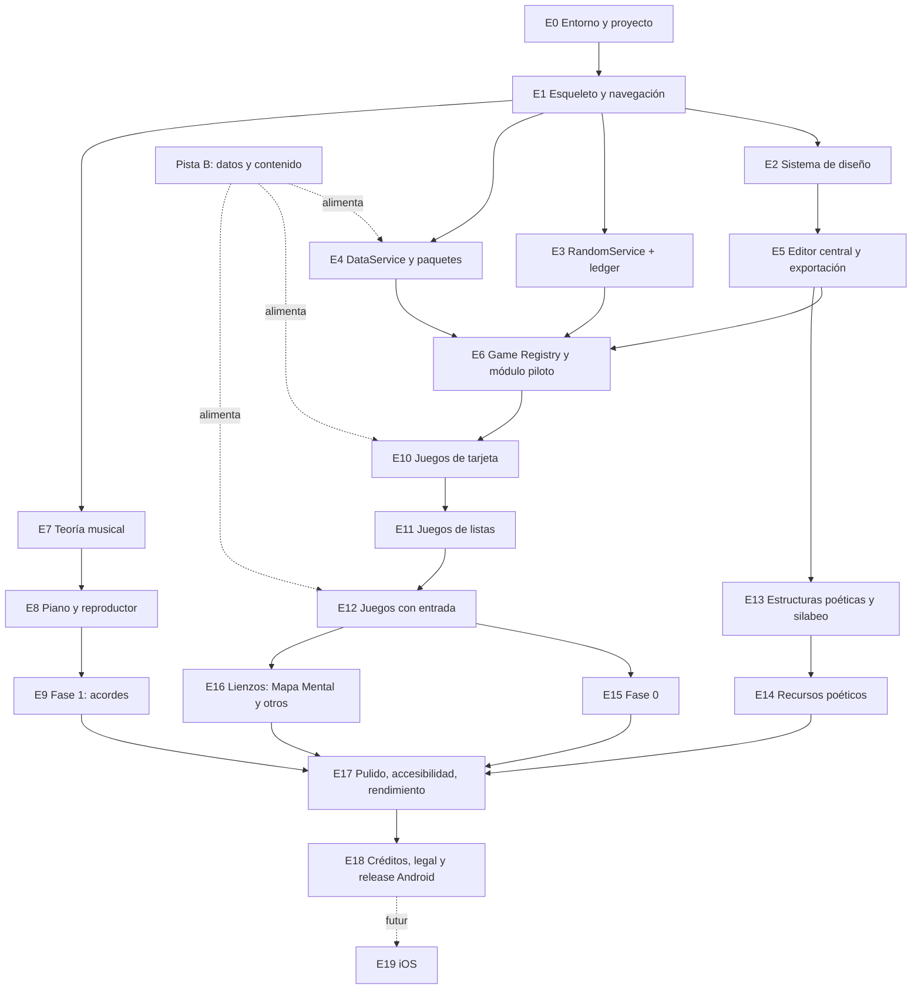

# IMPLEMENTATION_ROADMAP — Etapas priorizadas de desarrollo

Convenciones en `README.md`. Restricciones vigentes (ver `DECISIONS_AND_OPEN_QUESTIONS.md` §0): **todo gratuito**, **sin recuperación de borradores**, **imágenes mixtas**, **consulta legal pendiente**, **Android primero** (iOS diferido, código «iOS-ready»).

## 1. Principios del plan
1. **Etapas pequeñas y verificables.** Cada etapa termina con algo que se puede **abrir, tocar y probar**, y con pruebas automáticas cuando la lógica es pura.
2. **Primero cimientos, después Juegos.** Orden obligatorio del encargo: arquitectura → navegación → sistema de diseño → editor central → almacenamiento temporal → generación sin repetición → reproductor musical → recién entonces los Juegos, por módulos.
3. **Nunca los 32 Juegos a la vez.** Se implementan por familias de escena (`GAME_ARCHITECTURE.md` §11): primero tarjetas, luego listas, luego lienzos.
4. **Dos pistas en paralelo:** *Pista A: Código* (OpenCode) y *Pista B: Datos y contenido* (trabajo humano + scripts). Los Juegos necesitan datos; por eso la pista B arranca temprano con **paquetes de prueba pequeños** y crece después.
5. **Puertas de calidad:** una etapa no se da por terminada hasta cumplir su *Definición de terminado* (DoD) y pasar sus pruebas.
6. **Tamaño:** S = una sesión corta de trabajo con OpenCode; M = varias sesiones; L = varias semanas de trabajo parcial. Son órdenes de magnitud, no compromisos.

## 2. Mapa general

## 3. Etapas

Cada etapa lista: **Objetivo · Documentos de entrada · Tareas · Entregable · DoD · Tamaño**.

### E0 — Entorno y proyecto base (S)
- **Objetivo:** tener el proyecto corriendo en un dispositivo Android antes de escribir funciones.
- **Entrada:** `TECHNICAL_ARCHITECTURE.md`, `OPENCODE_INSTRUCTIONS.md`.
- **Tareas:**
  1. Instalar herramientas (Node, Git, editor, Android Studio o un teléfono Android con depuración USB, OpenCode).
  2. Crear el repositorio y el proyecto Expo con TypeScript.
  3. Crear `AGENTS.md`, `opencode.json` y las *skills* base (`OPENCODE_INSTRUCTIONS.md`).
  4. Crear el *development build* para Android y verificar que abre.
  5. Generar `DEPENDENCIES.md` con las versiones realmente instaladas.
- **Entregable:** pantalla «Hola» en el teléfono + repositorio con el commit inicial.
- **DoD:** la app abre en un dispositivo real; `npm test` y `npm run lint` corren (aunque sin pruebas todavía).
- **Nota de hardware:** si el emulador de Android resulta lento en la PC, usar un teléfono físico.

### E1 — Esqueleto y navegación (S)
- **Entrada:** `USER_FLOWS.md`, `TECHNICAL_ARCHITECTURE.md` §4–5.
- **Tareas:** rutas de Expo Router (Home, Material, Acordes, Juegos, Escribir, Ajustes), barra inferior, pantallas vacías, estructura de carpetas, *stores* de Zustand vacíos, configuración de TypeScript estricto.
- **Entregable:** navegación completa entre pantallas vacías con onboarding de 3 pantallas.
- **DoD:** se puede navegar a todas las secciones; el onboarding aparece solo en la primera apertura; el botón flotante del reproductor abre una hoja vacía.

### E2 — Sistema de diseño (M)
- **Entrada:** `DESIGN_SYSTEM.md`.
- **Tareas:** tokens (color, tipografía, espaciado, movimiento) en claro y oscuro; carga de fuentes; componentes base (`StimulusCard`, `WordChip`, `LockToggle`, `DiceButton`, `TimerBadge`, `SourceTooltip`, `EmptyState`, etc.); pantalla `/dev/gallery`.
- **Entregable:** la galería muestra cada componente en cada estado y tema.
- **DoD:** ningún componente usa valores fuera de los tokens; contraste AA verificado; texto al 200 % sin cortes.

### E3 — RandomService y ledger (M)
- **Entrada:** `RANDOMIZATION_SYSTEM.md`.
- **Tareas:** normalización y huellas, extracción por ciclos, ledger persistente, `pickGame()`, `reset()`, escritura diferida.
- **Entregable:** servicio con pruebas unitarias.
- **DoD:** pasan los criterios de aceptación 1–6 de `RANDOMIZATION_SYSTEM.md` §11; cobertura de lógica ≥ 90 %.
- **Por qué temprano:** todo Juego depende de esto.

### E4 — DataService y paquetes de datos (M)
- **Entrada:** `LEXICAL_DATABASE_AND_APIS.md`, `CONTENT_DATABASE.md`.
- **Tareas:** esquema SQLite, carga de paquetes, consultas por categoría, `source_meta`, pantalla «Créditos y licencias» generada desde datos, **paquete de prueba** (≈ 500 lemas inventados con licencia propia y ≈ 100 registros de contenido original).
- **Entregable:** `DataService` que entrega palabras y contenido de un paquete de prueba.
- **DoD:** una pantalla de desarrollo pide 30 palabras y muestra que no hay repetidas; falla con claridad si falta el paquete.
- **Pista B (paralela):** diseño de scripts de construcción del banco real (`LEXICAL_DATABASE_AND_APIS.md` §6) y del contenido original (`CONTENT_DATABASE.md` §5).

### E5 — Editor central y exportación (M)
- **Entrada:** `LYRIC_EDITOR_AND_EXPORT.md`.
- **Tareas:** modelo `Song`, secciones y estrofas, operaciones (crear, renombrar, reordenar, eliminar), selector de estructura (sin contenido aún), `EditorBridge`, deshacer/rehacer, insignia «sin exportar», `ExportService` y menú de compartir, aviso de «tu canción no se guarda».
- **Entregable:** editor funcional que exporta el texto en el formato exacto.
- **DoD:** pasan los criterios 1–7 de `LYRIC_EDITOR_AND_EXPORT.md` §9; la letra no sobrevive a cerrar la app.

### E6 — Game Registry y módulo piloto (M)
- **Entrada:** `GAME_ARCHITECTURE.md`, `GAME_CATALOG.md`.
- **Tareas:** contrato `GameModule`, registro, plantilla `GameIntro`, `EditorDock`, restauración de estado, dado de Juego, **un Juego piloto: G-02 Desde el Título** (el más simple).
- **Entregable:** lista de Juegos (placeholders para 31) + G-02 completo con intro, tarjeta, sorteo y envío al editor.
- **DoD:** el piloto pasa los criterios del catálogo; agregar un Juego nuevo requiere solo carpeta + una línea en el registro; el test de registro verifica 32 ids.

### E7 — Teoría musical (M)
- **Entrada:** `MUSIC_ENGINE.md` §2–3, §7–9.
- **Tareas:** modelo de acordes y ortografía, catálogo de tipos, detector de tonalidad, generador del dado, catálogo de relaciones armónicas (§8.1), biblioteca de progresiones por datos.
- **Entregable:** módulo de lógica pura con pruebas.
- **DoD:** pasan los criterios 1, 2, 3, 7 y 9 de `MUSIC_ENGINE.md` §13.

### E8 — Piano y reproductor (M–L)
- **Entrada:** `MUSIC_ENGINE.md` §5, §10.
- **Tareas:** carga de muestras, programación con reloj de audio, voicing con conducción de voces, controles (Play, Pausa, Loop, BPM deslizable 40–600, Silenciar), metrónomo con click percusivo, panel flotante, sesión de audio, manejo de interrupciones.
- **Entregable:** reproductor que suena una progresión fija con precisión.
- **DoD:** criterios 4, 5, 6, 8 y 10 de `MUSIC_ENGINE.md` §13. **Riesgo:** latencia/compatibilidad de la librería de audio (R-02); plan B documentado en `MUSIC_ENGINE.md` §10.2.

### E9 — Fase 1: pantalla de acordes (M)
- **Entrada:** `MUSIC_ENGINE.md` §4, §6–8, `USER_FLOWS.md` §6.
- **Tareas:** bloques de acorde, selector con ♯/♭, «+», candados, dado, detección en pantalla, exploración armónica con escucha, biblioteca de progresiones.
- **DoD:** el flujo completo de Fase 1 funciona sin conexión.

### E10 — Juegos de tarjeta (M, por lotes)
Juegos de estímulo único y de varias tarjetas independientes: **G-02 (ya), G-14, G-18, G-05, G-12, G-08, G-09, G-10, G-13, G-17, G-16, G-19** (en este orden).
- **Entrada:** ficha de cada Juego en `GAME_CATALOG.md` + datos de la pista B.
- **Tareas por Juego:** intro, tema visual, controlador, pruebas del controlador, integración con el dock.
- **Regla:** **un Juego por vez, con commit y prueba manual antes de seguir.**
- **DoD por Juego:** cumple la ficha y la plantilla de aceptación de `QA_AND_ACCEPTANCE_TESTS.md` §6. G-16 y las citas dependen de la consulta legal (usar solo contenido permitido, D-04).

### E11 — Juegos de listas (M)
**G-01, G-03, G-11, G-24** (columnas, revelado, posiciones, dados).
- Incluye `SwipeableCard` y los componentes `LockToggle` y `WordChip` en uso real.
- **DoD:** reglas de unicidad entre columnas, regeneración independiente y bloqueo.

### E12 — Juegos con entrada del usuario (M–L)
**G-04, G-06, G-07, G-15, G-20, G-22, G-25, G-26, G-27, G-32**, más **G-21 La Séptima** (lee el editor, depende de E13 para contar palabras por verso).
- **DoD:** cada Juego respeta sus reglas literales (p. ej. G-06: la columna solo se muestra al completar sus 10 palabras).

### E13 — Estructuras poéticas y silabeo (M–L)
- **Entrada:** `POETIC_STRUCTURES.md`.
- **Tareas:** `structures.json` con 22 estructuras, silabeador por reglas, detector de rima, validador de esquema no bloqueante, fichas y ejercicios, selector en el editor.
- **DoD:** criterios de `POETIC_STRUCTURES.md` §8; conjunto de pruebas de ≥ 300 versos.
- **Pista B:** redactar los ejemplos pendientes; resolver las preguntas P-1 a P-6.

### E14 — Recursos poéticos (S–M)
- **Entrada:** `POETIC_RESOURCES.md`.
- **Tareas:** `resources.json`, navegación, búsqueda por nombre y por efecto, desafíos.
- **DoD:** criterios de `POETIC_RESOURCES.md` §7.

### E15 — Fase 0 (L)
- **Entrada:** `GAME_CATALOG.md` (Fase 0), `PRIVACY_AND_OFFLINE.md`.
- **Orden:** F0-5 ¿Por qué? → F0-2 Páginas matutinas → F0-4 El Espía → F0-3 Prompt (imágenes) → **F0-1 Voz desatada** (la más compleja).
- **Voz desatada, subetapas:** (a) grabadora y reproducción; (b) transcripción asistida manual (siempre disponible); (c) motor del sistema on-device con comprobación de disponibilidad y sin envío remoto; (d) selección y edición de fragmentos; (e) exportación. El modelo propio de voz es una etapa futura.
- **DoD:** pruebas de privacidad de `PRIVACY_AND_OFFLINE.md` §8.

### E16 — Lienzos: Mapa Mental y otros (L)
Orden: **G-23 Mapa Mental** (con prueba de rendimiento de 121 nodos) → **G-29 Cut-up** → **G-30 Trenza** → **G-28 Collage textual** → **G-31 Cadena de letras**.
- **Mapa Mental, subetapas:** modelo y archivo `.mapa.json` → lienzo con zoom/desplazamiento → generación de asociaciones sin IA → edición/regeneración/eliminación → exportación a imagen y PDF → importación.
- **DoD:** 60 fps con 121 nodos en un dispositivo de gama media; el archivo exportado se reimporta idéntico.

### E17 — Pulido, accesibilidad y rendimiento (M)
Revisión transversal: accesibilidad, estados vacíos y errores, rendimiento, tamaño de la app, textos, animaciones con «reducir movimiento», identidad visual de cada Juego (ver `DESIGN_SYSTEM.md` §6).

### E18 — Créditos, legal y publicación en Android (S–M)
- Pantalla de «Créditos y licencias» completa, política de privacidad (página estática), resultado de la **consulta legal** aplicado al contenido, firma y compilación de producción, ficha de tienda **[VERIFICAR costos del registro de la tienda; D-01 «todo gratuito»]**.
- **Alternativa gratuita:** distribuir el APK directamente.

### E19 — iOS (futuro, bloqueado por D-01)
Requiere una Mac o cuenta de desarrollo paga para publicar y probar en iPhone. Hasta entonces el código se mantiene «iOS-ready» (sin APIs exclusivas de Android; revisar permisos y sesión de audio).

## 4. Pista B: datos y contenido (en paralelo)

| Hito | Contenido | Documento |
|---|---|---|
| B0 | Paquete de prueba (500 lemas, 100 registros) | `CONTENT_DATABASE.md`, `LEXICAL_DATABASE_AND_APIS.md` |
| B1 | Scripts de construcción y informe de calidad del léxico | `LEXICAL_DATABASE_AND_APIS.md` §6 |
| B2 | Banco léxico real (≥ 30.000 lemas, con licencias) | ídem |
| B3 | Listas curadas: dados, escenarios, restricciones, prompts, preguntas | `CONTENT_DATABASE.md` §3 |
| B4 | Catálogo de metadatos culturales (títulos, canciones, personajes) | ídem §5 |
| B5 | Catálogo de imágenes (paquete + API) | ídem §6 |
| B6 | Lista de progresiones preestablecidas (la aporta el usuario) | `MUSIC_ENGINE.md` §9 |
| B7 | Ejemplos de estructuras pendientes y respuestas P-1…P-6 | `POETIC_STRUCTURES.md` |
| B8 | Consulta legal | `DECISIONS_AND_OPEN_QUESTIONS.md` D-04 |

**Dependencias:** E10 necesita B3–B5 en versión mínima; E12 necesita B2 al menos parcial; E9 necesita B6 (puede usarse un conjunto provisional).

## 5. Riesgos del plan y respuestas

| Riesgo | Señal de alerta | Respuesta |
|---|---|---|
| Modelos gratuitos pierden contexto | Código que ignora la arquitectura | Tareas más chicas, un archivo por vez, releer `AGENTS.md` (`OPENCODE_INSTRUCTIONS.md`) |
| Módulos nativos fallan | Error al compilar o crasheos | Plan B por librería; no seguir hasta resolverlo |
| Banco léxico por debajo de 30.000 | Informe de calidad | Estrategia de contingencia de `LEXICAL_DATABASE_AND_APIS.md` §7 |
| Rendimiento del Mapa Mental | < 60 fps | Reducir nodos visibles, simplificar render, optimizar capas |
| Alcance excesivo | Etapas que no cierran | Congelar nuevas ideas; cada idea nueva va a una lista «después de v1» |
| Cansancio por el tamaño | Etapas largas sin resultados visibles | Hitos visibles en cada etapa; celebrar entregables |

## 6. Control de cambios
- Cualquier cambio de la esencia de un Juego original requiere aprobación explícita del usuario.
- Cambios de alcance se anotan en `DECISIONS_AND_OPEN_QUESTIONS.md` con un nuevo ID.
- Cada etapa cerrada se registra en el tablero del `README.md` y en un `CHANGELOG.md` del repositorio.

## 7. Resumen de la secuencia recomendada (compacto)

| Orden | Etapa | Tamaño |
|---|---|---|
| 1 | E0 Entorno | S |
| 2 | E1 Navegación | S |
| 3 | E2 Diseño | M |
| 4 | E3 Aleatoriedad | M |
| 5 | E4 Datos | M |
| 6 | E5 Editor y exportación | M |
| 7 | E6 Registry + piloto | M |
| 8 | E7 Teoría musical | M |
| 9 | E8 Piano | M–L |
| 10 | E9 Fase 1 | M |
| 11 | E10 Juegos de tarjeta | M |
| 12 | E11 Juegos de listas | M |
| 13 | E12 Juegos con entrada | M–L |
| 14 | E13 Estructuras | M–L |
| 15 | E14 Recursos | S–M |
| 16 | E15 Fase 0 | L |
| 17 | E16 Lienzos | L |
| 18 | E17 Pulido | M |
| 19 | E18 Release Android | S–M |
| — | E19 iOS | Futuro |
