# LEXICAL_DATABASE_AND_APIS — Fuentes, licencias y banco de palabras

Convenciones en `README.md`. Relacionado: D-14, D-15, R-03, R-04.

**Meta [ORIGINAL]:** base local de al menos 30.000 lemas españoles únicos y validados (sustantivos, verbos, adjetivos y palabras con más de una categoría), con frecuencia, relaciones semánticas, variantes regionales y vocabulario rioplatense. Cada fuente conserva atribución y licencia. No se inventan datos ni categorías gramaticales.

## 1. Lo que encontré de cada fuente

Las cinco fuentes son de **naturaleza distinta**. No sirven para lo mismo.

| # | Fuente | Tipo | Aporta | No aporta | Licencia / condiciones | Estado de verificación |
|---|---|---|---|---|---|---|
| 1 | **Datamuse** | API de consulta | Rimas (`rel_rhy`, `rel_nry`) con `v=es` (500.000 términos) y metadatos opcionales | Relaciones semánticas avanzadas en español (limitadas a inglés según el encargo) | Gratuita sin clave hasta 2027-02-01 (100.000 consultas/día); desde entonces requiere clave. Atribución requerida en la documentación de la app; no guardar resultados | Verificado 2026-11-21 en `datamuse.com/api/`: sin clave, CORS, logs temporales descartados al día siguiente |
| 2 | **Wiktionary / Wiktextract (Kaikki)** | Conjunto de datos descargable | Entradas con categoría gramatical, glosas, etiquetas regionales, derivados y relaciones léxicas | Frecuencia de uso | Contenido de Wiktionary: licencias de contenido libre con *ShareAlike* **[VERIFICAR texto exacto]** | Página consultada (ver 1.1) |
| 3 | **MCR / Spanish WordNet** | Base de relaciones semánticas | Sinónimos (synsets), hiperónimos/hipónimos, partes-todo, categoría gramatical | Frecuencia; vocabulario coloquial y regional | Parte española del MCR 3.0: **CC BY 3.0** (uso comercial permitido con atribución) | Verificado (ver 1.2) |
| 4 | **OpenSLR SLR21** | Lista de frecuencias | Palabras con frecuencia derivada de un corpus grande | **Categoría gramatical, lema, relaciones** | **CC BY-SA 3.0 US** | Verificado (ver 1.3) |
| 5 | **RAE API (rae-api.com)** | API de consulta, **no oficial** | Definiciones y consulta de palabras del diccionario | Descarga masiva autorizada; relaciones semánticas | Es una API no oficial de datos de la RAE; **no confirmé términos de uso ni límites** | **[VERIFICAR]**; ver 1.4 |

### 1.1 Wiktionary/Wiktextract (kaikki.org)
Lo que dice la página que enlazaste:
- Es la **edición en español de Wiktionary**: cubre cientos de idiomas con glosas y metadatos en español. Para palabras del *español* hay que **filtrar por idioma = Español** dentro de ese volcado.
- Descarga cruda en JSONL: **1,2 GB** sin comprimir o **98,8 MB** comprimida, generada de un volcado de noviembre de 2026 y actualizada con regularidad.
- **Aviso en la propia página:** ese formato crudo está marcado como **DEPRECATED** y se retirará; recomiendan usar los datos ya procesados bajo `kaikki.org/dictionary/`.
- **[REC]:** en la Etapa de datos, evaluar los datos procesados de «Spanish» de kaikki (hay dos orígenes posibles: edición inglesa y edición española de Wiktionary; comparar cobertura de categorías gramaticales y de etiquetas regionales antes de elegir uno).
- Pide citar a Tatu Ylonen (LREC 2022) en uso académico y agradece enlazar a kaikki.org. Incluirlo en «Créditos».

### 1.2 MCR 3.0 / Spanish WordNet
- La parte española del MCR 3.0 se distribuye bajo **CC BY 3.0**, libre para uso comercial y de investigación, según el grupo UPC/EHU. Los datos de WordNet inglés dentro del paquete usan la licencia original de WordNet.
- **Cuidado:** una versión derivada en formato LMF figura en un repositorio con licencia **GPL 3.0**. **No usar esa derivación**; usar la distribución original del MCR (la que enlazaste) para mantener CC BY.
- Cobertura: la versión LMF indicada contiene unas 37.900 entradas léxicas **[VERIFICAR para la distribución original]**. Es útil para sinónimos y jerarquías, pero **no alcanza por sí sola** los 30.000 lemas por categoría ni cubre bien el habla rioplatense.
- Distribuye los datos en el formato del MCR (synsets). Requiere un parser propio; no hay API de consulta.

### 1.3 OpenSLR SLR21
- Lista de palabras con frecuencias derivada del corpus Spanish Gigaword. **22 MB** en JSON comprimido.
- Es una lista **plana de formas**: no trae lema ni categoría gramatical, e incluirá nombres propios, formas flexionadas, errores y extranjerismos.
- Licencia **CC BY-SA 3.0 (EE. UU.)**: exige atribución y compartir bajo la misma licencia las obras derivadas (ver riesgo R-04).
- Uso propuesto: **solo para puntuar frecuencia** y filtrar ruido, cruzándola con las categorías de Wiktionary/WordNet.

### 1.4 RAE API
- Es una API **no oficial**, con clientes en distintos lenguajes. No requiere clave según el cliente de terminal que consulté.
- No encontré términos de uso que autoricen **almacenar** el contenido. Las definiciones de la RAE tienen sus propios derechos.
- **[REC]:** no usarla como fuente de la base ni llamarla desde la app. Opcional: usarla manualmente en el pipeline para **validar muestras** (verificar que un lema existe), sin guardar sus textos. Antes de cualquier otro uso, leer sus términos y contactar al proveedor.

## 2. Tabla de decisión por necesidad

| Necesidad | Fuente principal | Complemento |
|---|---|---|
| Lista de lemas y categoría gramatical | Wiktionary/Wiktextract | WordNet (confirma sustantivo/verbo/adjetivo) |
| Frecuencia de uso | SLR21 | — |
| Sinónimos y relaciones | MCR/WordNet | Relaciones de Wiktionary (sinónimos, derivados) |
| Argentinismos y rioplatense | Etiquetas regionales de Wiktionary | **Lista propia curada** (autoría original, sin dependencia de licencias) |
| Formas flexionadas | Wiktionary | — |
| Validar existencia de una palabra | Cruce de 2 fuentes | RAE API como control manual |
| Palabras con rima | Cálculo propio (ver 5) | — |

## 3. Criterio de «lema validado» [REC] (D-15)
Un lema entra al banco si cumple **todas**:
1. Lo reconocen **al menos dos fuentes independientes**, o está en Wiktionary con categoría gramatical **y** supera un umbral de frecuencia.
2. No es nombre propio, sigla, abreviatura ni expresión de más de una palabra (los Juegos de palabras sueltas lo requieren; las locuciones se guardan aparte si hacen falta).
3. No figura en la lista negra (insultos fuertes, vocabulario inapropiado, topónimos, errores).
4. Tiene categoría gramatical asignada por una fuente verificable. Si no, **no se infiere**: queda fuera.
Un lema con más de una categoría genera un registro por categoría y comparte el mismo `lemma_id`.

## 4. Esquema de la base (SQLite) [REC]

```
lemma(id TEXT PK, lemma TEXT, lemma_norm TEXT, freq_rank INT, freq_score REAL,
      syllables INT, stress_pos INT, rhyme_cons TEXT, rhyme_aso TEXT, flags INT)
lemma_pos(lemma_id, pos TEXT CHECK (pos IN ('n','v','adj')), source TEXT)
inflection(form_norm TEXT, lemma_id, features TEXT)
relation(lemma_id_a, lemma_id_b, type TEXT, source TEXT)   -- syn, hyper, hypo, part, deriv, related
region(lemma_id, region TEXT, source TEXT)                  -- ar, rioplatense, es, mx...
source_meta(source TEXT PK, name TEXT, license TEXT, url TEXT, version TEXT, attribution TEXT)
fingerprint(lemma_id, fp TEXT)                              -- huella normalizada, ver RANDOMIZATION_SYSTEM
```

- **`lemma.id` estable:** hash determinístico de `lemma_norm`. Así el ledger de no repetición sigue válido cuando se actualizan los paquetes.
- Tablas separadas por fuente de relaciones, con `source` obligatorio, para poder retirar una fuente si cambia una licencia.
- Normalización: Unicode NFC; minúsculas; versión sin tildes para búsquedas (`lemma_norm`), conservando la forma con tilde para mostrar.

## 5. Datos calculados en la construcción (no en el teléfono)
- Número de sílabas, posición del acento, y claves de rima consonante y asonante, calculados con un silabeador/acentuador propio (ver `POETIC_STRUCTURES.md`). Se validan contra una muestra revisada a mano.
- Palabras agudas, graves y esdrújulas (afecta el cómputo métrico y a las seguidillas).
- Esto permite que Palabra Portal (rimas y aliteraciones), Cadena de letras y Palabras Clavadas funcionen offline y rápido.

## 6. Pipeline de construcción

```mermaid
flowchart LR
  A[Descargas<br/>Wiktionary, MCR, SLR21] --> B[Ingesta y filtrado<br/>idioma, formato]
  B --> C[Normalización NFC<br/>y lematización]
  C --> D[Asignación de categoría<br/>sin inferir]
  D --> E[Cruce con frecuencia]
  E --> F[Filtros: propios, siglas,<br/>lista negra]
  F --> G[Regla de validación<br/>2 fuentes]
  G --> H[Cálculo de sílabas,<br/>acento y rima]
  H --> I[Relaciones semánticas]
  I --> J[Exportación SQLite<br/>+ informe de calidad]
```



Cada ejecución emite un **informe de calidad** (cantidad por categoría y fuente, rechazados y motivo, muestra aleatoria de 200 lemas para revisión humana). El paquete no se publica si no hay revisión.

## 7. Cobertura esperada y plan de contingencia
- Los 30.000 lemas son **probables** combinando Wiktionary y WordNet, pero **la cifra por categoría no está verificada**. El informe de calidad de la Etapa de datos confirma el número real **antes** de construir Juegos que dependan del volumen.
- Si no se llega por categoría: ampliar con formas flexionadas útiles (p. ej., participios como adjetivos), relajar el umbral de frecuencia y/o sumar fuentes adicionales (a investigar). **No rellenar con datos inventados.**

## 8. Licencias y atribución
- Cada fuente conserva su licencia en `source_meta`. La pantalla **Créditos y licencias** se genera automáticamente desde esa tabla.
- **Riesgo ShareAlike (R-04):** SLR21 (CC BY-SA 3.0) y Wiktionary (contenido libre con SA) exigen que las obras derivadas se compartan bajo licencia compatible. Opciones: (a) distribuir el paquete léxico bajo la misma licencia SA y mantener el código aparte; (b) minimizar el uso de datos SA a señales no copiables (p. ej., puntajes numéricos). **Decisión pendiente y recomendable con asesoramiento legal.** El paquete de **contenido cultural** debe quedar separado del léxico.
- La **lista rioplatense propia** y las **frases de la casa** son de autoría original y llevan `source = 'original'`.

## 9. Uso en los Juegos (resumen)

| Juego | Qué consume del banco |
|---|---|
| 1 Asociación Libre, 3 Unión, 11 Palabras Clavadas, 14 Otra Perspectiva | Lemas por categoría, sin repetición entre columnas |
| 6 Palabra Portal, 23 Mapa Mental | Relaciones semánticas, rimas, aliteraciones |
| 24 Dados Líricos, 27 Traslado de universo | Listas de dominio (lugar, objeto, emoción, universo temático); estas listas son contenido curado, no léxico |
| 31 Cadena de letras | Lista de formas válidas (con flexiones) para validar palabras |
| 21 La Séptima | Palabras aleatorias de cualquier categoría |

Detalle por Juego en `GAME_CATALOG.md` y `GAME_ARCHITECTURE.md`.

## 10. Preguntas abiertas
1. Confirmar condiciones de **Datamuse** (idiomas, límites, almacenamiento) y decidir si se usa solo en la construcción.
2. Decidir qué edición de Wiktionary (española o inglesa) da mejor cobertura de categoría gramatical y regional.
3. Resolver el esquema de licencias ShareAlike (sección 8).
4. Encargar o redactar la lista rioplatense propia (orden de miles; tamaño a definir).
