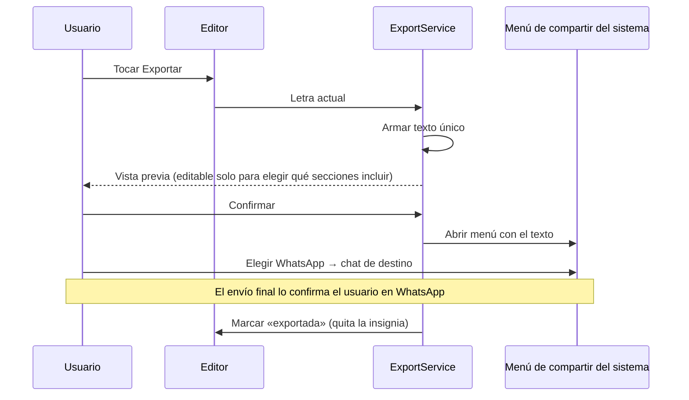

# LYRIC_EDITOR_AND_EXPORT — Editor central, secciones, estrofas y exportación

Convenciones en `README.md`. Relacionado: `GAME_ARCHITECTURE.md` (EditorBridge), `POETIC_STRUCTURES.md` (tanda 4), `PRIVACY_AND_OFFLINE.md` (D-03, sin persistencia).

## 1. Principios
1. **Un solo editor** para toda la app. Ningún Juego tiene editor propio.
2. Los Juegos **sugieren**, nunca modifican destructivamente la letra.
3. La letra **no se guarda**: vive en memoria y se pierde al cerrar la app. La única salida es **exportar**.
4. El editor funciona sin conexión y es usable con una mano.

## 2. Modelo de datos

```ts
interface Song {
  sections: Section[];
}
interface Section {
  id: string;
  name: string;                 // «ESTROFA 1», «ESTRIBILLO», personalizado…
  kind: 'intro'|'verse'|'chorus'|'bridge'|'outro'|'custom';
  stanzas: Stanza[];            // una o varias
}
interface Stanza {
  id: string;
  structureId: string | null;   // p. ej. 'redondilla', 'serventesio' (ver POETIC_STRUCTURES.md)
  text: string;                 // texto libre; las líneas se separan con \n
}
```
- Cada **sección** puede tener **varias estrofas** y cada estrofa una **estructura distinta** [ORIGINAL].
- Las secciones predefinidas son INTRO, ESTROFA 1, ESTROFA 2, ESTRIBILLO, PUENTE y OUTRO, y se pueden crear secciones personalizadas.
- `structureId = null` significa estrofa libre.

## 3. Operaciones del usuario

| Operación | Detalle |
|---|---|
| Crear sección | Desde plantilla o personalizada; el nombre se normaliza a MAYÚSCULAS al exportar |
| Renombrar | Editable en línea |
| Reordenar | Arrastrar con feedback háptico; alternativa accesible con botones «subir/bajar» |
| Eliminar sección | Confirmación si tiene texto |
| Agregar/eliminar estrofa | Dentro de cada sección; confirmación si tiene texto |
| Elegir estructura | Selector por estrofa (abre `POETIC_STRUCTURES`) |
| Consultar estructura | Panel de ayuda: esquema, métrica, ejemplo, errores comunes |
| Editar libremente | Sin restricciones: el esquema es una **guía**, no una barrera |
| Duplicar sección | Útil para estribillos repetidos [REC] |
| Deshacer/rehacer | Pila en memoria (≈ 100 pasos) [REC] |

## 4. Pantalla del editor

```
┌─────────────────────────────────────┐
│ ‹  Canción      [♪] [Exportar]      │
├─────────────────────────────────────┤
│ ESTROFA 1                       ⋯   │
│  Redondilla (ABBA)         ⓘ        │
│  ┌───────────────────────────────┐  │
│  │ línea 1                       │ A│
│  │ línea 2                       │ B│
│  │ línea 3                       │ B│
│  │ línea 4                       │ A│
│  └───────────────────────────────┘  │
│  + Estrofa                          │
│ ESTRIBILLO ...                      │
│ + Sección                           │
├─────────────────────────────────────┤
│ Panel de estímulo (si viene de un   │
│ Juego): minimizable                 │
└─────────────────────────────────────┘
```
- Insignia con la **letra de rima** por verso (A, B…) cuando hay estructura elegida.
- Contador de **sílabas por verso** opcional (ver `POETIC_STRUCTURES.md`, silabeo) como ayuda, no como error.
- Insignia **«sin exportar»** si hay cambios desde la última exportación (D-03).
- Botón de nota musical abre el **reproductor de acordes** como panel superpuesto.
- Teclado: el área activa sube con el teclado; el cursor siempre visible; el panel de estímulo se puede minimizar.

## 5. Integración con Juegos
Mediante `EditorBridge` (`GAME_ARCHITECTURE.md` §5):
- «Llevar al editor» inserta texto **en el cursor** o al final de una sección elegida; nunca reemplaza.
- El panel de estímulo mantiene visible lo esencial del Juego (palabra núcleo, verso insistente, cuatro palabras, etc.).
- **La Séptima** lee la letra en modo solo lectura para detectar versos y sugerir sustituciones; el usuario decide si aplicarlas **una por una**.
- Fase 0: los fragmentos seleccionados (Voz desatada, etc.) se pueden enviar al editor o exportar aparte.

## 6. Exportación

### 6.1 Formato del texto [ORIGINAL]
Un **único texto** con toda la canción. Los nombres de sección en **MAYÚSCULAS**; **debajo** del nombre, el nombre de la estructura usada; luego la letra de la estrofa.

```
ESTRIBILLO

Serventesio (ABAB)

[Letra de la estrofa]

ESTROFA 1

Redondilla (ABBA)

[Letra de la estrofa]

PUENTE

Pareado (AA)

[Letra de la estrofa]
```

### 6.2 Reglas de armado
1. Orden: el orden actual de las secciones del editor.
2. Si una sección tiene **varias estrofas**: se repite la línea de estructura antes de cada una, separadas por una línea en blanco. Si todas comparten estructura, igual se indica en cada una [REC, para no ambiguar].
3. Estrofa sin estructura: se omite la línea de estructura (no se escribe «libre»).
4. Estrofas vacías se omiten; secciones vacías no se exportan.
5. Separación: una línea en blanco entre bloques; saltos de línea normalizados a `\n`.
6. Sin caracteres de formato propios de WhatsApp (asteriscos, guiones bajos): **no** poner negritas automáticas para no alterar el texto del usuario [REC]. Si se quisiera, sería una opción en Ajustes.
7. Opción en Ajustes: «Incluir nombre de la estructura» (activada por defecto, según el encargo).
8. No se incluye metadata (fechas, nombre de la app) salvo que el usuario lo active [REC].

### 6.3 Flujo


- Se usa la **API de compartir del sistema** para texto (no se llama a WhatsApp directamente), de modo que el usuario elige app y chat.
- **Nunca** se envían mensajes sin acción explícita.
- Estado «exportada» solo en memoria (no hay persistencia).

### 6.4 Exportar parcial
- Elegir **qué secciones** incluir (casillas) antes de compartir [REC].
- Exportar **solo una sección** desde su menú «⋯».

### 6.5 Límite de tamaño
Los mensajes individuales de WhatsApp admiten hasta **65.536 caracteres** según fuentes de terceros **[VERIFICAR con documentación oficial]**; el límite de **4.096** corresponde a la API de WhatsApp Business, que no aplica al menú de compartir del usuario. Una canción normal queda muy por debajo. Aun así: si el texto supera **60.000 caracteres** [REC], se ofrece dividir en partes (por sección).

### 6.6 Otras salidas
| Material | Salida |
|---|---|
| Canción completa | Texto por menú de compartir |
| Fragmentos de Voz desatada | Texto por menú de compartir (todos juntos, enumerados) |
| Material de Fase 0 | Texto por menú de compartir |
| Mapa Mental | Archivo `.mapa.json`, imagen, PDF, o menú de compartir |
| Copiar al portapapeles | Opción adicional [REC] |

Los fragmentos de Voz desatada se exportan con encabezado «FRAGMENTOS — VOZ DESATADA» y numeración; no incluyen el audio.

## 7. Casos límite
| Caso | Comportamiento |
|---|---|
| Letra vacía | «No hay nada para exportar» |
| Nombre de sección vacío | Se usa «SECCIÓN n» |
| Nombre con minúsculas | Se convierte a MAYÚSCULAS en la exportación |
| Líneas vacías al final de la estrofa | Se recortan |
| Emojis y caracteres especiales | Se conservan |
| Falla del menú de compartir | Mensaje de error y botón «Copiar texto» |
| Mapa Mental sin guardar | Ver `USER_FLOWS.md` §11 |

## 8. Accesibilidad
- Cada sección y estrofa tiene etiqueta de accesibilidad con su nombre y estructura.
- Reordenar tiene alternativa sin arrastre.
- Compatible con tamaños de texto grandes sin cortar líneas de la letra.
- Contraste AA en las insignias de rima.

## 9. Criterios de aceptación
1. Exportar «ESTRIBILLO (Serventesio) + ESTROFA 1 (Redondilla) + PUENTE (Pareado)» produce exactamente el formato de §6.1.
2. Los nombres salen siempre en MAYÚSCULAS; la estructura aparece debajo.
3. El menú de compartir se abre con un único texto y no se envía nada sin confirmación del usuario.
4. Reordenar secciones cambia el orden de exportación.
5. Un Juego nunca cambia texto existente sin acción del usuario.
6. Cerrar la app elimina la letra (D-03), sin rastros en el almacenamiento.
7. La Séptima propone sustituciones sin alterar el texto hasta que el usuario las aplica.
Más pruebas en `QA_AND_ACCEPTANCE_TESTS.md` (tanda 5).
