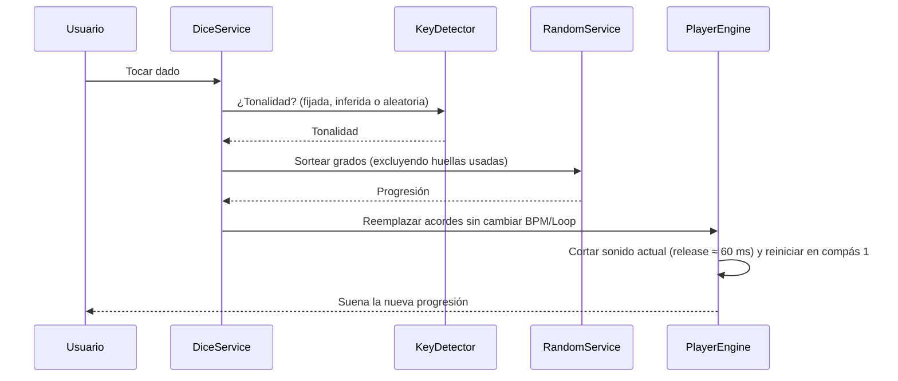
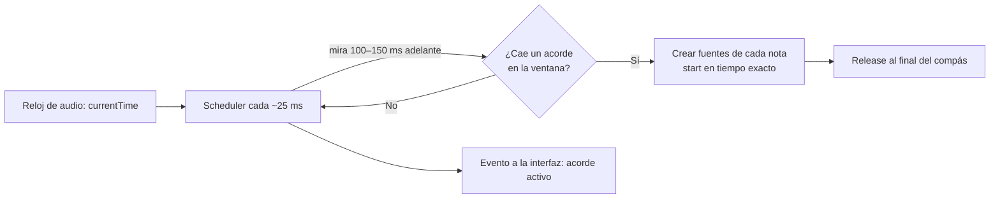

# MUSIC_ENGINE — Acordes, progresiones, piano, BPM, tonalidades y exploración armónica

Convenciones en `README.md`. Resumen de producto en `PRODUCT_SPEC.md` §4.2. Decisiones relacionadas: D-06 (alteraciones), D-07 (dado y tonalidad), D-08 (rango de BPM), D-09 (piano).

## 1. Alcance
La Fase 1 permite armar una progresión de hasta **8 acordes**, escucharla con piano, generar progresiones al azar con un dado, detectar su tonalidad y explorar escalas, modos y sustituciones. Todo funciona **sin conexión**.
Referencia de experiencia: la fluidez de chordchord.com (tocar el dado y escuchar al instante). **No** se copian sus funciones innecesarias.

## 2. Modelo de datos

```ts
type PitchClass = 0|1|2|3|4|5|6|7|8|9|10|11;

interface Note { letter: 'C'|'D'|'E'|'F'|'G'|'A'|'B'; accidental: -1|0|1; } // ♭ / natural / ♯
interface Chord {
  id: string;            // uuid de sesión
  root: Note;
  quality: QualityId;    // ver sección 3
  bass?: Note;           // inversión/bajo alterno (opcional, futuro)
  locked: boolean;       // protegido del dado
}
interface Progression {
  chords: Chord[];       // 1 a 8
  bpm: number;           // 40–200
  loop: boolean;
  muted: boolean;
  key: KeyState;         // ver sección 7
}
```
- **Ortografía enarmónica correcta** (G♯ vs A♭) se resuelve según la tonalidad vigente; sin tonalidad, se usa la preferencia del usuario (♯ o ♭, por defecto ♯ en mayores con sostenidos y ♭ en el resto) [REC].
- Los cálculos de notas, intervalos, escalas y acordes se apoyan en una librería de teoría (candidata: `tonal` **[VERIFICAR licencia y versión]**) y se cubren con las pruebas de la sección 13.

## 3. Catálogo de tipos de acorde

Intervalos en semitonos desde la raíz. Lista cerrada y ampliable por datos.

| QualityId | Símbolo | Intervalos | Nota |
|---|---|---|---|
| `maj` | (nada) | 0 4 7 | Mayor |
| `min` | m | 0 3 7 | Menor |
| `dim` | dim / ° | 0 3 6 | Disminuido |
| `aug` | aug / + | 0 4 8 | Aumentado |
| `sus2` | sus2 | 0 2 7 | |
| `sus4` | sus4 | 0 5 7 | |
| `maj7` | maj7 | 0 4 7 11 | |
| `m7` | m7 | 0 3 7 10 | |
| `7` | 7 | 0 4 7 10 | Dominante |
| `m7b5` | m7♭5 | 0 3 6 10 | Semidisminuido |
| `dim7` | dim7 | 0 3 6 9 | |
| `6` | 6 | 0 4 7 9 | |
| `m6` | m6 | 0 3 7 9 | |
| `add9` | add9 | 0 4 7 14 | |
| `maj9` | maj9 | 0 4 7 11 14 | |
| `m9` | m9 | 0 3 7 10 14 | |
| `9` | 9 | 0 4 7 10 14 | |
| `7sus4` | 7sus4 | 0 5 7 10 | |

Notación: **cifrado americano** (C, Dm, G7). Opcional en Ajustes: mostrar nombres latinos (Do, Re, Mi…) [REC]. La lectura por lector de pantalla expande el símbolo («La menor séptima»).

## 4. Interfaz del selector (resumen)
- Pantalla inicial: **2 bloques** de acorde + botón «+» (ej.: `A — E — +`).
- Tocar un bloque abre el selector: grilla de raíces **C D E F G A B** con selector **♯/♭** (D-06) y lista visual de tipos (los más usados primero: mayor, menor, 7, maj7, m7, sus2, sus4, dim, aug, «más…»).
- Cada bloque muestra el nombre y, al tocarlo, lo **hace sonar** (vista previa).
- Quitar un acorde: deslizar hacia arriba o mantener presionado → «Eliminar» (mínimo 1).
- **Candado** por bloque (D del dado).
- Máximo 8: el «+» desaparece y se muestra «Máximo 8 acordes».
- Editar un acorde **no altera** los demás.

## 5. Reproductor

| Control | Regla |
|---|---|
| Play / Pausa | Reproduce desde el acorde 1; Pausa conserva la posición |
| Loop | Si **off**: se reproduce **una vez** y se detiene. Si **on**: repite indefinidamente |
| BPM | **40–200** (D-08), por defecto 90, paso 1. El cambio se aplica **desde el siguiente compás** |
| Silenciar | Silencia el sonido pero **la reproducción continúa** y se ve el avance |
| Duración | **1 acorde = 1 compás de 4 tiempos**; duración de un compás = `4 × 60 / BPM` segundos |

### Panel flotante
Según el encargo, en fases posteriores el reproductor queda oculto en un control accesible. Al tocarlo aparece **por encima** del contenido actual (hoja deslizable) **sin perder** la posición de escritura ni el estado del Juego. El estado de la progresión vive en un *store* global independiente de las pantallas.

## 6. Dado de progresiones

### 6.1 Reglas [ORIGINAL]
Al tocar el dado:
- Cambia **toda** la progresión (salvo acordes con candado, D-07).
- **Mantiene la cantidad** de acordes.
- **Respeta la tonalidad** seleccionada cuando corresponda.
- **Conserva el BPM** y el **estado de Loop**.
- **Reproduce instantáneamente** la nueva progresión.

### 6.2 Algoritmo [REC]
1. **Tonalidad objetivo:** si el usuario fijó una tonalidad, usarla. Si no, y hay acordes con candado, inferirla con el detector (§7) y tomar la de mayor compatibilidad. Si no hay nada, sortear una de las 24 (12 mayores + 12 menores).
2. **Grados:** generar una secuencia de grados diatónicos con una **tabla de transiciones ponderada** (cadena de Markov simple) propia de la tonalidad mayor o menor. Ejemplos de tendencias comunes: I → {IV, V, vi, ii, iii}; V → {I, vi}; ii → {V, vii°}; etc. Los pesos viven en un archivo de datos editable.
3. **Calidad de cada acorde:** la diatónica de la tonalidad (triada o séptima según un ajuste «Simple / Con séptimas», por defecto Simple).
4. **Variedad opcional:** ajuste «Aventura» (desactivado por defecto) que permite, con baja probabilidad, un préstamo modal o un dominante secundario del catálogo de §8.
5. **Posiciones bloqueadas:** los acordes con candado se mantienen en su posición; los demás se generan alrededor.
6. **Restricciones:** no más de 2 acordes iguales consecutivos; no todos iguales; el primer acorde tiene sesgo hacia la tónica.
7. **No repetición:** la huella de la progresión (secuencia de acordes + tonalidad) pasa por el ledger (`RANDOMIZATION_SYSTEM.md` §6.5); si ya salió, se resortea hasta 50 veces.
8. **Reproducción instantánea:** el sorteo debe completarse en < 50 ms (es lógica pura y sin acceso a disco).



Si el reproductor estaba detenido, el dado **igualmente** reproduce la nueva progresión (regla del encargo).

## 7. Detección de tonalidad

### 7.1 Requisito [ORIGINAL]
Analizar los acordes y mostrar las tonalidades posibles; ante ambigüedad, mostrar varias opciones con **probabilidad o nivel de compatibilidad**; el usuario puede **cambiarla manualmente**.

### 7.2 Candidatas
24 tonalidades (12 mayores y 12 menores naturales). Los modos (dórico, mixolidio…) se tratan en la exploración (§8) y no como candidatas de detección en v1 [REC].

### 7.3 Puntaje
Para cada candidata se calcula un puntaje con reglas explícitas y verificables:
1. **Pertenencia diatónica:** cada acorde suma si todas sus notas pertenecen a la escala de la candidata (menor: se acepta la armónica para V y vii° como caso reconocido); suma parcial si es un acorde reconocible del catálogo de préstamos o dominantes secundarios; penaliza si no.
2. **Peso por posición:** primer y último acorde pesan más.
3. **Cadencias:** bonus por V → I o V7 → i, IV → I, ii → V.
4. **Tónica:** bonus si algún acorde coincide con la tónica de la candidata.
5. Se normaliza a **0–100** respecto del máximo posible.

Salida: lista ordenada con puntaje y **etiqueta de nivel**: Alta (≥ 80), Media (60–79), Baja (< 60) [umbrales propuestos].
**Importante:** el puntaje es un **nivel de compatibilidad** basado en reglas, **no una probabilidad estadística**; la interfaz lo muestra así (no como «%» de probabilidad).
Cuando dos candidatas están a menos de 5 puntos (p. ej. relativas), se marca **«ambigua»** y se muestran ambas.

### 7.4 Ejemplos de referencia (para pruebas)
| Progresión | Resultado esperado |
|---|---|
| Am – F – C – G | C mayor y A menor, ambiguas; ambas de nivel Alta |
| C – F – G – C | C mayor, Alta, sin ambigüedad relevante |
| Dm – G7 – Cmaj7 | C mayor, Alta (ii–V–I) |
| C – E – Am – F | C mayor con **Media** (E mayor es dominante secundario de Am) |
| Un solo acorde | Muestra varias con nivel Bajo y aviso «pocos datos» |

### 7.5 Edición manual
El usuario puede elegir otra tonalidad de la lista. La elección se guarda como `key.source = 'manual'` y el dado y la exploración la usan. Un botón «Volver a automática» reactiva la detección.

## 8. Exploración armónica

Sección expandible. **Regla del encargo:** no inventar relaciones; solo teoría verificable, con explicación breve y audición en piano.

### 8.1 Catálogo cerrado de relaciones permitidas
Cada sugerencia debe provenir de una **regla formal** del catálogo (archivo de datos con nombre, definición, función y fuente). Fuera del catálogo, no se muestra.

| Relación | Definición formal | Ejemplo (en C mayor) |
|---|---|---|
| Escala **relativa** | Escala que comparte las mismas notas y tiene como tónica el VI grado (mayor→menor) o el III (menor→mayor) | A menor |
| Escala **paralela** | Misma tónica, modo opuesto | C menor |
| **Modos** del sistema diatónico | Rotaciones de la escala mayor: jónico, dórico, frigio, lidio, mixolidio, eólico, locrio | D dórico comparte notas con C mayor |
| Modos de la **misma tónica** | Los 7 modos construidos sobre la misma raíz | C lidio |
| **Pentatónicas** | Mayor/menor de 5 notas derivadas de la escala | A menor pentatónica |
| Escalas menores **armónica** y **melódica** | Definición por intervalos | A menor armónica |
| **Sustituto relativo** | Acorde con dos notas comunes a la misma función (I↔vi, IV↔ii) | C → Am |
| **Sustituto tritonal** | V7 → ♭II7 (comparten el tritono) | G7 → D♭7 |
| **Dominante secundario** | V7 del grado destino | A7 → Dm |
| **Préstamo modal** | Acorde de la tonalidad paralela | F → Fm (iv) |
| **Dominante suspendido** | V → Vsus4 → V | G → Gsus4 |
| **Disminuido de paso** | vii° o ♯i° entre grados | C – C♯dim – Dm |

La blues se muestra como «uso habitual en la práctica popular», marcada como convención, no como relación estricta.

### 8.2 Presentación
Para el acorde o la progresión elegida: pestañas **Escalas / Modos / Sustituciones**, cada ítem con: nombre, notas, **explicación de una o dos líneas**, botón **Escuchar** (escala ascendente o acorde alternativo en piano) y botón **Reemplazar** (aplica la sustitución sin alterar los demás acordes, con opción de deshacer).

## 9. Biblioteca de progresiones preestablecidas

Diseño **basado en datos** (la lista definitiva se incorporará después).

```json
{
  "id": "pop-axis-I-V-vi-IV",
  "name": "I – V – vi – IV",
  "mode": "major",
  "degrees": ["I","V","vi","IV"],
  "tags": { "emotion": ["esperanzador"], "style": ["pop"], "feel": ["cíclica"] },
  "keys": ["C","G","D","A","E","F","Bb"],
  "notes": "Texto breve propio",
  "origin": "original"
}
```
- Se guardan en **grados romanos** y se **transponen** a la tonalidad elegida.
- Clasificación: por **tonalidad**, **emoción**, **estilo** y **característica** (según el encargo).
- Los nombres de ejemplo («axis», etc.) son **placeholders**; los textos descriptivos deben ser de autoría propia.
- El ledger evita repetir la misma preestablecida hasta agotar el conjunto.
- Cargar una preestablecida respeta cantidad máxima (8); si trae más, se rechaza en la compilación del dato.

## 10. Motor de audio (piano)

### 10.1 Sonido [REC]
- Piano de **muestras** con licencia libre. Candidato verificado: **Salamander Grand Piano V3** de Alexander Holm, licencia **CC BY 3.0** (exige atribución): Yamaha C5 muestreado con 16 capas de velocidad, a intervalos de tercera menor (original de ≈ 394 MB, por lo que se usa una versión reducida).
- Reducción propuesta: **1–2 capas de velocidad**, muestras cada tercera menor (≈ 30 notas) en AAC/MP3, objetivo de **pocos MB**; las notas intermedias se obtienen con `playbackRate`. Existen paquetes de terceros con subconjuntos en MP3; verificar que conserven la licencia y la atribución **[VERIFICAR]**.
- La atribución debe figurar en «Créditos y licencias».

### 10.2 Librería [REC]
`react-native-audio-api` (Software Mansion): API compatible con Web Audio que permite programar el inicio de cada nota (`start(tiempo)`), usar `AudioBufferSourceNode` y variar `playbackRate`. Incluye una guía de teclado de piano basada en muestras. Requiere **development build** (no funciona en Expo Go). Limitación conocida: con auriculares Bluetooth puede haber latencia propia del enlace; no depende de la app.
Alternativa de contingencia: `expo-audio` con precarga de muestras **[VERIFICAR]**.

### 10.3 Programación del tiempo

- El tiempo se mide con el **reloj de audio**, no con temporizadores de JavaScript (evita desvíos).
- Cambio de BPM: se recalcula desde el próximo compás.
- Loop: al terminar el último compás, si Loop está activo, se programa el compás 1 sin silencio intermedio.

### 10.4 Voicing
- Voz grave: raíz una o dos octavas abajo (C2–B2).
- Notas del acorde en C3–C5, **conducción de voces mínima** entre acordes consecutivos (elegir inversión que minimice el movimiento total) para que suene musical y no «salte».
- Sin arpegio ni rasgueo en v1 (ajuste futuro).

### 10.5 Sesión de audio
- iOS: categoría **reproducción** para que suene aunque el interruptor de silencio esté activado (D-09); respetar interrupciones (llamadas) y pausar.
- Android: manejar foco de audio.
- Al ir a segundo plano: pausar.

## 11. Estados y errores
| Caso | Comportamiento |
|---|---|
| Muestras no cargadas aún | Indicador de carga; los botones de reproducción quedan deshabilitados con aviso |
| Muestras faltantes/corruptas | Error con «Reintentar»; la edición de acordes sigue disponible |
| Volumen del sistema en cero | Aviso discreto una vez |
| Progresión de 1 acorde | Permite reproducir; la detección avisa «pocos datos» |

## 12. Accesibilidad
- Nombres de acorde legibles por lector de pantalla.
- Controles del reproductor accesibles con etiquetas claras; el estado Play/Pausa se anuncia.
- No depender solo del color para marcar el acorde activo (usar forma/contorno).
- Reducir movimiento: sin animaciones de pulso si el sistema lo pide.

## 13. Criterios de aceptación y pruebas
1. **Ortografía:** F♯m7 = F♯ A C♯ E; B♭maj7 = B♭ D F A; E♭ aug = E♭ G B.
2. **Dado:** 10 tiradas con 5 acordes → siempre 5 acordes; BPM y Loop idénticos; sin acordes con candado alterados.
3. **Dado con tonalidad fijada:** todos los acordes pertenecen a la tonalidad (modo «Simple»).
4. **Reproducción:** a 120 BPM un acorde dura 2,0 s; 4 acordes sin Loop = 8,0 s y se detiene.
5. **Loop:** con Loop activo no hay silencio audible entre el último y el primer compás.
6. **BPM:** 40 y 200 aceptados; 39 y 201 rechazados.
7. **Detección:** los casos de §7.4 dan el resultado esperado.
8. **Panel:** abrir y cerrar el reproductor desde el editor no mueve el cursor ni cambia el Juego.
9. **Sustituciones:** cada sugerencia mostrada corresponde a una regla del catálogo §8.1.
10. **Offline:** todo lo anterior funciona en modo avión.
Más pruebas en `QA_AND_ACCEPTANCE_TESTS.md` (tanda 5).

## 14. Preguntas abiertas
1. Lista definitiva de progresiones preestablecidas y sus tonalidades (la proporcionará el usuario).
2. ¿Mostrar notación latina por defecto? (Argentina usa ambas).
3. ¿Agregar arpegio/rasgueo en una versión posterior?
4. Confirmar librería de audio y licencia de la versión reducida del piano **[VERIFICAR]** en la Etapa de música.
