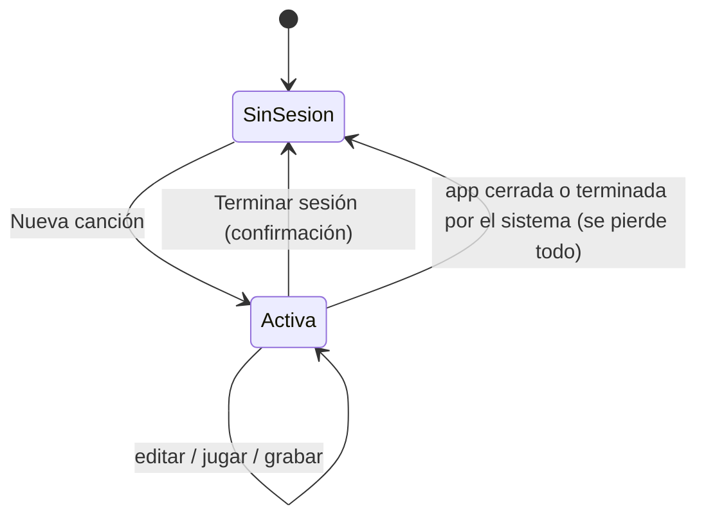
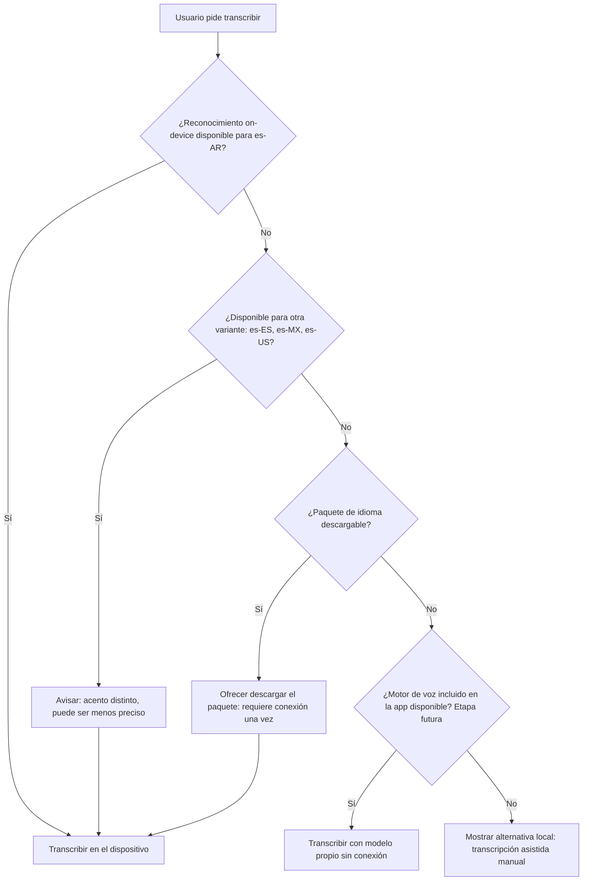

# PRIVACY_AND_OFFLINE — Almacenamiento, grabación y transcripción offline

Convenciones en `README.md`. Decisiones relacionadas: D-03, D-11, D-12.

## 1. Principio rector
Lo que el usuario **crea** (letras, grabaciones, transcripciones, mapas) no sale del dispositivo y no se conserva más allá de la sesión de trabajo. Lo que la app **usa** (palabras, contenido, muestras de piano) vive instalado en el dispositivo.

## 2. Clasificación de datos

| Dato | Tipo | ¿Persiste? | Dónde | Se borra cuando |
|---|---|---|---|---|
| Letra, secciones, estrofas | Creativo | No | Solo memoria | Terminar sesión o cierre de la app |
| Grabaciones de Voz desatada | Creativo/sensible | Temporal | Carpeta temporal | Fin de sesión, cierre de la app o borrado manual |
| Transcripciones y fragmentos | Creativo | Temporal | Solo memoria (audio: carpeta temporal) | Fin de sesión |
| Material de Fase 0 (páginas, prosa) | Creativo | Temporal | Solo memoria (audio: carpeta temporal) | Fin de sesión |
| Estado de Juegos | Creativo | Temporal | Solo memoria | Fin de sesión |
| Mapa Mental en curso | Creativo | Temporal | Solo memoria | Fin de sesión |
| Archivo de Mapa Mental exportado | Creativo | **Lo guarda el usuario donde elija** | Fuera de la app | Lo gestiona el usuario |
| Ledger de no repetición | Técnico | Sí | Almacenamiento local | Reinicio manual en Ajustes |
| Preferencias y configuración | No sensible | Sí | Almacenamiento local | Reinstalación |
| Paquetes de palabras/contenido | Datos de la app | Sí | Bases SQLite | Actualización o desinstalación |

El ledger guarda **solo identificadores y huellas técnicas** (nunca texto del usuario ni estímulos completos). Ver `RANDOMIZATION_SYSTEM.md`.

## 3. Ciclo de vida de la sesión (actualizado: D-03 resuelta)

Decisión del usuario: **no hay borrador de recuperación**. Todo lo creativo vive solo en memoria y en archivos temporales de grabación; si la app se cierra, se pierde.

Reglas:
1. «Terminar sesión» pide confirmación y ofrece exportar antes.
2. Al ir a segundo plano, la app conserva el estado en memoria mientras el sistema no la cierre. Si el sistema la cierra, se pierde; al reabrir se empieza limpio.
3. Mitigación sin persistir: aviso visible «Tu canción no se guarda. Exportala para conservarla», acceso rápido a Exportar y confirmación al salir con contenido sin exportar.
4. Al iniciar la app se **barren** grabaciones y archivos temporales huérfanos de una ejecución anterior.
5. El borrado elimina archivos reales (no solo referencias) y los datos creativos se excluyen de las copias de seguridad del sistema [VERIFICAR mecanismo por plataforma].
6. Primera apertura: pantalla breve que explica que nada se guarda y por qué.

## 4. Permisos
- **Micrófono** (Voz desatada). Se pide al usar la grabadora, nunca en el arranque.
- **Reconocimiento de voz** (iOS). Solo al iniciar la transcripción.
- Sin ubicación, contactos, fotos ni seguimiento.
- Textos de permiso en es-AR, claros y específicos (por ejemplo: «Usamos el micrófono para grabar tu voz. La grabación queda en tu teléfono y se borra al terminar la sesión.»).
- Si el usuario deniega: estado vacío explicativo con acceso a Ajustes del sistema.

## 5. Transcripción sin conexión

### 5.1 Requisito [ORIGINAL]
La transcripción debe funcionar sin conexión. Si el dispositivo no admite reconocimiento offline en español, **no** hacer una transcripción remota silenciosa: informar y ofrecer una alternativa local.

### 5.2 Hallazgos técnicos
- `expo-speech-recognition` envuelve el reconocedor nativo de iOS (SFSpeechRecognizer) y de Android (SpeechRecognizer). Tiene una opción para **impedir que el audio vaya a la red** (`requiresOnDeviceRecognition`), que solo se activa si el dispositivo lo soporta, y permite consultar los idiomas soportados en el dispositivo.
- En iOS, si el reconocimiento on-device no está disponible y no se fuerza la opción, el sistema puede usar el servicio de Apple si hay conexión. Por eso **la app debe forzar la opción** y comprobar disponibilidad antes de empezar. Que un reconocedor «funcione sin red» no equivale a que sea totalmente local salvo que se fuerce.
- En Android, el reconocimiento on-device depende de que el paquete de idioma esté instalado (la librería recomienda comprobar los idiomas soportados antes) y de la versión del sistema **[VERIFICAR versión mínima; la documentación consultada indica Android 13+ para funciones on-device y transcripción de archivos]**. Descargar un modelo de idioma requiere conexión **una vez**.
- La librería puede transcribir también **archivos de audio grabados** (iOS y Android 13+), lo que habilita el flujo «grabar ahora, transcribir después».

### 5.3 Cascada de motores [REC]

1. **Motor del sistema on-device** (primera implementación, menor costo de desarrollo).
2. **Modelo de voz incluido en la app** (p. ej., una variante cuantizada de un modelo abierto de reconocimiento) como segunda etapa **[VERIFICAR]** librería, tamaño, calidad en español rioplatense y rendimiento en iPhone. No implementarlo hasta que la Etapa de Fase 0 esté estable.
3. **Alternativa local siempre disponible: transcripción asistida manual.** El reproductor permite retroceder 5 s, velocidad 0,5×–1×, bucle de tramo y un campo de texto al lado. No requiere ningún reconocedor.

Nunca se envía audio a servidores. Si ninguna opción on-device existe, la app lo dice con claridad y ofrece la alternativa manual.

### 5.4 Calidad esperada
El reconocimiento on-device suele rendir menos que el servidor en voz espontánea, con ruido o con vocabulario rioplatense. El producto lo asume: la transcripción es **editable**, y el texto original de la transcripción se conserva separado de los fragmentos modificados (regla de Voz desatada).

## 6. Funcionamiento sin conexión por función

| Función | Sin conexión |
|---|---|
| Fase 0 completa | Sí (la imagen del ejercicio Prompt depende de D-05) |
| Fase 1 (piano, acordes, tonalidad) | Sí |
| Fase 2: Juegos | Sí, con paquetes instalados |
| Juegos con enlaces (5, 8, 9, 10, 17, 21) | El Juego funciona; **abrir el enlace** requiere conexión |
| Exportar/compartir texto | Sí (compartir depende de la app destino) |
| Actualizar paquetes de datos | No |

## 7. Privacidad en las tiendas
- Si ningún dato personal sale del dispositivo ni se usan SDK de terceros que recolecten datos, la declaración de privacidad de las tiendas puede indicar que no se recopilan datos **[VERIFICAR requisitos vigentes de cada tienda]**.
- Las tiendas piden una **URL de política de privacidad**: hace falta una página estática (alojamiento gratuito).
- No incluir SDK de analíticas ni de publicidad en v1.

## 8. Criterios de aceptación (resumen)
1. Con modo avión activado, grabar y transcribir (si el motor on-device está disponible) funciona.
2. Con el motor on-device no disponible, **no se realiza ninguna solicitud de red de audio** y aparece la alternativa manual.
3. «Terminar sesión» deja sin archivos de audio ni texto del usuario en el almacenamiento de la app.
4. Tras cerrar y reabrir la app no queda ningún texto ni audio de la sesión anterior.
5. El ledger no contiene texto escrito por el usuario.
Detalle de pruebas en `QA_AND_ACCEPTANCE_TESTS.md` (tanda 5).
