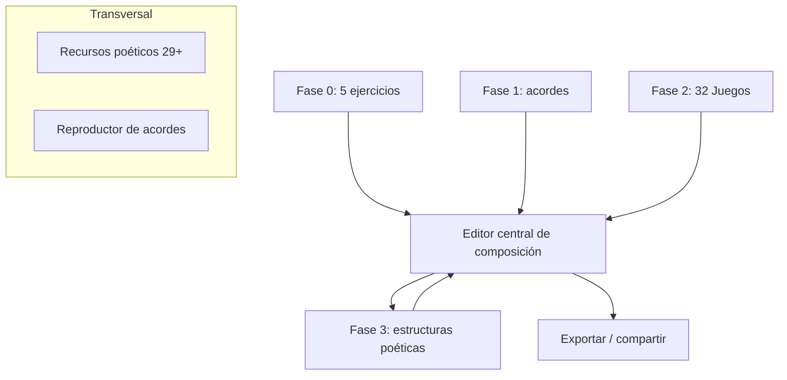

# PRODUCT_SPEC — Definición del producto

Ver convenciones en `README.md`. Decisiones abiertas en `DECISIONS_AND_OPEN_QUESTIONS.md`.

## 1. Propuesta de valor

Una app para compositores y escritores de canciones que **no escribe por vos**: te da juegos, estímulos y restricciones para desbloquear la imaginación, un piano para probar acordes mientras escribís y un sistema de estructuras poéticas para pulir la letra.

**Diferencial:** es un espacio creativo basado en Juegos, no un editor de letras ni un generador automático.

## 2. Usuarios objetivo

| Perfil | Necesidad | Qué le damos |
|---|---|---|
| Compositor con bloqueo creativo | Arrancar | Fase 0 y Juegos con estímulos |
| Letrista sin formación métrica | Dar forma a las ideas | Fase 3 y recursos poéticos |
| Músico que arma acordes antes que letra | Probar armonías | Fase 1 con piano |
| Docente o tallerista de escritura | Usar los métodos en clase | Juegos con instrucciones y ejemplos propios |

Hipótesis de uso: sesiones de 15–60 min, a menudo con auriculares, en el sofá, en tránsito o con la guitarra en las manos. Pantalla vertical de iPhone, uso con una mano.

## 3. Principios de producto

1. **Los Juegos son el producto.** Cada uno conserva su método original; solo se mejora presentación y navegación.
2. **Un solo editor.** Todos los Juegos escriben en el mismo editor central. Ninguno tiene editor propio.
3. **El estímulo nunca destruye lo escrito.** Los Juegos sugieren; no modifican la letra existente sin acción explícita del usuario.
4. **Privacidad por diseño.** Sin cuentas, sin nube, sin analíticas en v1. Lo creativo no persiste (ver `PRIVACY_AND_OFFLINE.md`).
5. **Offline primero.** Banco léxico, contenido, piano y transcripción funcionan sin conexión.
6. **Sin IA generativa en v1**, con costuras listas para sumarla.
7. **Identidad visual por Juego** sobre un sistema de diseño común (ver `DESIGN_SYSTEM.md`).

## 4. Estructura funcional

El recorrido recomendado es 0 → 1 → 2 → 3, pero **ninguna fase es obligatoria** y el usuario puede saltar libremente. Solo la Fase 0 se *recomienda* explícitamente.

### 4.1 Fase 0 — Buscando el material
Cinco ejercicios opcionales (Voz desatada, Páginas matutinas, Prompt, El Espía, ¿Por qué?). Detalle de reglas en `GAME_CATALOG.md` (sección Fase 0) y flujos en `USER_FLOWS.md`.

Mensaje central de Fase 0 **[ORIGINAL]**: no hace falta que lo escrito sea interesante, bonito, coherente ni útil; el objetivo es escribir sin censura y entrar en flow.

Requisitos clave:
- Voz desatada: grabadora, reproducción, transcripción **sin conexión**, selección de fragmentos, edición de fragmentos sin alterar la transcripción original, exportación de fragmentos.
- Páginas matutinas: tres páginas, indicador de progreso, temporizador opcional.
- Prompt: prompt e imagen independientes; cambiar solo uno o ambos; gesto de deslizar izquierda/derecha.
- El Espía: preguntas guía, cuenta regresiva de observación de 60 s, luego escritura.
- ¿Por qué?: escritura libre con inserción de «¿Por qué?» y mínimo sugerido de 2–4 carillas; solo se muestran las instrucciones.

### 4.2 Fase 1 — Progresión de acordes
Especificación completa en `MUSIC_ENGINE.md`. Resumen:
- 4 a 16 acordes (inicia con 4 y un «+»).
- Dado: regenera toda la progresión conservando cantidad, BPM y estado de Loop; respeta tonalidad y acordes bloqueados; reproduce al instante.
- Detección de tonalidad con varias opciones y nivel de compatibilidad, editable a mano.
- Exploración armónica (relativas, paralelas, modos, sustituciones) solo con teoría verificable, audible en piano.
- Reproductor: Play, Pausa, Loop, BPM (máx. 300), mute. Un acorde = un compás de 4 tiempos.
- En fases posteriores el reproductor queda oculto en un panel accesible y se abre por encima del contenido sin perder posición de escritura ni estado del Juego.

### 4.3 Fase 2 — Los 32 Juegos
Catálogo completo en `GAME_CATALOG.md`; mecánica común en `GAME_ARCHITECTURE.md`.
Cada Juego tiene: pantalla inicial (título, objetivo, paso a paso, ejemplos, botón «Comenzar»), interfaz interactiva propia y acceso al editor central.
Hay un **dado de Juego aleatorio** que no repite Juego hasta completar el ciclo.

### 4.4 Fase 3 — Refinamiento
22 estructuras (16 de estrofa + 5 de composición completa + decasílabo tritónico anapéstico) con esquema, métrica, acentos, ejemplo original, errores frecuentes y guía para contar sílabas. Ver `POETIC_STRUCTURES.md`.

### 4.5 Recursos poéticos
Biblioteca de 29 recursos originales más ampliaciones fundamentadas, con búsqueda por nombre y por efecto. Ver `POETIC_RESOURCES.md`.

## 5. Editor central
Secciones (INTRO, ESTROFA n, ESTRIBILLO, PUENTE, OUTRO, personalizadas), varias estrofas por sección, estructura poética por estrofa, reordenar/renombrar/agregar/eliminar. Exportación única en texto con nombres de sección en MAYÚSCULAS y estructura debajo. Ver `LYRIC_EDITOR_AND_EXPORT.md`.

## 6. Requisitos no funcionales

| Área | Requisito |
|---|---|
| Plataformas | iPhone (prioridad); Android con paridad funcional razonable |
| Conectividad | Todo núcleo funciona sin conexión; la red solo se usa para actualizar paquetes de datos [REC] y abrir enlaces externos |
| Rendimiento | Arranque en frío ≤ 3 s en iPhone de gama media [REC]; interacción a 60 fps; latencia de piano perceptiblemente inmediata |
| Peso | Objetivo de instalación inicial razonable; paquetes grandes (imágenes, modelo de voz) descargables bajo demanda [REC] |
| Accesibilidad | VoiceOver/TalkBack, Dynamic Type, contraste AA mínimo, objetivos táctiles ≥ 44 pt, reducción de movimiento respetada |
| Privacidad | Ver `PRIVACY_AND_OFFLINE.md` |
| Idioma | es-AR; textos externalizados para i18n futura |
| Teclado | El editor debe mantener el cursor visible, no tapar estímulos clave y permitir ocultar el estímulo para ganar espacio |
| Estados | Vacíos, de error, sin permisos y sin datos descritos por pantalla en `USER_FLOWS.md` |

## 7. Monetización (preparación, sin implementar)
- v1 gratuita, sin anuncios [REC: coherente con privacidad].
- `EntitlementService` abstracto; en v1 siempre concede acceso completo.
- Candidatos a funciones *premium* futuras (no obligatorias): más paquetes de contenido, IA opcional, copias de seguridad cifradas del usuario.

## 8. Métricas
Sin analíticas en v1 [REC] para sostener la promesa de privacidad. Si más adelante se agregan, deben ser opt-in, anónimas y documentadas.

## 9. Fuera de alcance v1
IA generativa, cuentas, sincronización, comunidad/compartir dentro de la app, edición de audio, partituras, panel de administración, otros idiomas.
