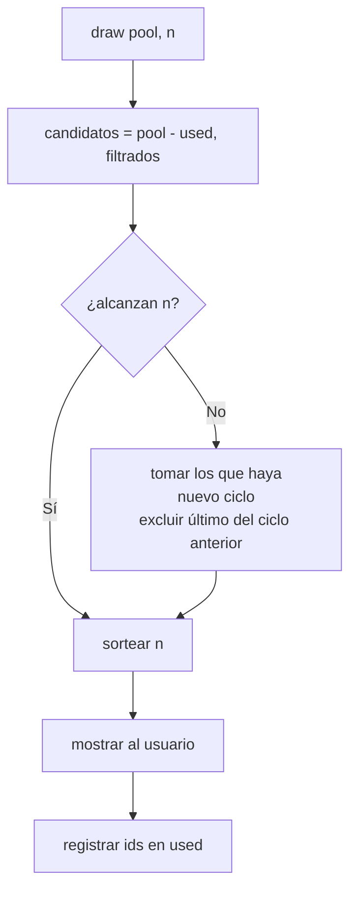

# RANDOMIZATION_SYSTEM — Identificadores y no repetición

Convenciones en `README.md`. Reglas de origen: sección 9 del encargo. Relacionado: `PRIVACY_AND_OFFLINE.md`, `LEXICAL_DATABASE_AND_APIS.md`.

## 1. Niveles de garantía [ORIGINAL]
| Nivel | Garantía |
|---|---|
| 1 | Sin repetición dentro de una partida/sesión |
| 2 | Sin repetición entre sesiones del mismo dispositivo, aunque la app se cierre |
| 3 | Entre usuarios distintos **no** se garantiza nada |

La sesión creativa se pierde al cerrar la app (D-03), pero **el ledger de no repetición sí persiste** (es técnico, no creativo).

## 2. Conceptos
- **Pool:** conjunto de elementos candidatos de una categoría (p. ej. `words.noun`, `titles`, `images.evocative`, `games`).
- **Elemento:** tiene `id` estable único dentro de su pool.
- **Ledger:** registro local por pool de los elementos ya entregados.
- **Ciclo:** recorrido de un pool hasta agotarlo. Al agotarse, empieza otro.
- **Huella (fingerprint):** hash de la forma normalizada del texto, para detectar duplicados entre pools y Juegos.

## 3. Identificadores
- Formato: `<pool>:<hash8>`; el hash sale de la forma normalizada del contenido (determinístico). Ejemplo: `noun:a3f91c2e`.
- **Estables entre versiones de datos:** no se usan índices ni autoincrementales.
- Si un elemento se retira en una actualización, su id queda en el ledger sin efecto (se ignora).

## 4. Normalización para huellas
1. Unicode NFC → minúsculas.
2. Quitar tildes y diacríticos **solo** para la huella (se conserva `ñ`).
3. Quitar signos de puntuación y comillas; colapsar espacios.
4. Opcional para títulos/frases: quitar artículos iniciales («el», «la», «un»…) [REC].
5. Huella = hash (p. ej. SHA-1 truncado a 64 bits) del resultado.
Dos elementos con igual huella son **el mismo** aunque estén en pools o Juegos distintos.

## 5. Algoritmo de extracción (sin repetición con ciclos)

Estructura de datos por pool (compacta, sin textos):
```
ledger[pool] = { cycle: int, used: Set<id> | Bitset, lastOfPrevCycle: id | null }
```
Algoritmo `draw(pool, n, constraints)`:
1. Candidatos = `pool − used` que cumplan `constraints` (categoría, tema, tipo de palabra…).
2. Si los candidatos son menos que `n`: tomar los que haya, **cerrar el ciclo** (`cycle++`, vaciar `used` salvo lo ya tomado en esta llamada, guardar `lastOfPrevCycle`) y completar desde el pool nuevo, excluyendo lo ya tomado.
3. Primer elemento de un ciclo nuevo: **excluir `lastOfPrevCycle`** si hay más de un candidato [ORIGINAL: «evitar que el primero sea el último del ciclo anterior»].
4. Elegir con un generador pseudoaleatorio (semilla del sistema) sin sesgo (Fisher-Yates parcial).
5. Registrar los elegidos en `used` **solo cuando se muestran al usuario** (no al calcular), con escritura diferida y agrupada para no frenar la interfaz.



## 6. Restricciones adicionales

### 6.1 Unicidad dentro de un grupo
Para Juegos como Asociación Libre (30 palabras únicas en 3 columnas): se pasa un `groupSet` de huellas ya tomadas en la misma partida; `draw` las excluye además del ledger.

### 6.2 Unicidad entre Juegos
Los pools de títulos, frases, canciones, personajes y obras comparten **un índice global de huellas** construido al compilar los paquetes (ver `CONTENT_DATABASE.md`): un mismo título no puede existir en dos pools distintos. En ejecución, el ledger usa la huella, no solo el id, de modo que lo mostrado en un Juego cuenta como usado para los demás.

### 6.3 Regeneración y descarte
- Un elemento mostrado cuenta como **usado** aunque el usuario lo descarte o regenere.
- «Sugerencia» (Palabra Portal): si el usuario la borra y pide otra, recibe una distinta; la anterior sigue como usada.

### 6.4 Selección de Juego aleatorio
Pool `games` de 32 ids. Sin repetición hasta completar el ciclo de 32; luego se reinicia evitando que el primero sea el último anterior. Cuenta como usado el Juego **abierto**, no el simplemente sorteado y rechazado [REC: si el usuario vuelve atrás sin empezar, se mantiene como usado para respetar «no presentar el mismo Juego»].

### 6.5 Progresiones y dados
- Pool de progresiones preestablecidas: mismo mecanismo.
- Dado de acordes (Fase 1) genera combinaciones: se guarda la **huella** de la progresión (secuencia normalizada de acordes + tonalidad), no la lista de todas las posibles. Se descarta y vuelve a sortear si la huella ya está usada; tras N intentos fallidos [REC N=50] se acepta y se avisa internamente.
- Dados Líricos: cada dado es su propio pool; «volver a tirar uno» saca otro del mismo pool.

### 6.6 Imágenes
Pool por catálogo (incluido y por API). Se registra el id del catálogo; para imágenes de API, el id de la fuente + proveedor. Sin conexión solo se sortea del paquete incluido.

## 7. Qué se guarda en el ledger (y qué no)
**Sí:** `pool`, `cycle`, ids/huellas usadas, `lastOfPrevCycle`, versión del paquete de datos.
**No:** textos del usuario, letras, estímulos completos, tiempos de uso.

Tamaño: con 30.000 lemas por pool, un bitset ocupa ≈ 4 KB por pool; las huellas de 64 bits ≈ 240 KB por 30.000 elementos. Irrelevante para el almacenamiento.

## 8. Almacenamiento y consistencia
- Persistencia en almacenamiento local clave-valor o tabla SQLite propia (no en los paquetes de contenido, que se reemplazan).
- Escrituras agrupadas (*debounce* ≈ 500 ms) y forzadas al pasar a segundo plano.
- Si el ledger se corrompe: reiniciarlo vacío (peor caso: se repiten elementos) y no bloquear la app.
- Ajustes: «Reiniciar historial de no repetición» (por pool o total).
- Actualización de paquetes: ids estables; los elementos nuevos entran al pool con prioridad natural; los eliminados se ignoran.

## 9. Interfaz del servicio (contrato)

```ts
interface RandomService {
  draw(pool: PoolId, n: number, opts?: {
    filter?: (item: PoolItem) => boolean;
    excludeFingerprints?: Set<string>;   // grupo actual
  }): Promise<PoolItem[]>;
  markShown(items: PoolItem[]): void;    // registra en ledger
  pickGame(): Promise<GameId>;
  reset(pool?: PoolId): Promise<void>;
  stats(pool: PoolId): { total: number; used: number; cycle: number };
}
```
Regla: **prohibido `Math.random()` fuera de este servicio** (ver `TECHNICAL_ARCHITECTURE.md`).

## 10. Casos límite
| Caso | Comportamiento |
|---|---|
| Pool con menos elementos que `n` | Se entregan todos y se informa; no se repiten en la misma llamada |
| Filtro demasiado restrictivo (0 candidatos tras reinicio de ciclo) | Se relaja el filtro opcional y se registra; si es obligatorio, error controlado |
| Dos ciclos en una sola llamada | Se admite; excluye lo tomado en la llamada |
| Dos huellas iguales en el mismo pool | Error en la compilación del paquete (no debe llegar a la app) |
| Cambio de versión de datos con ids estables | El ledger se conserva |

## 11. Criterios de aceptación
1. Con un pool de 10 elementos y 25 extracciones de 1, ningún elemento se repite dentro de cada bloque de 10 y el primero del ciclo 2 ≠ último del ciclo 1.
2. Tras cerrar y reabrir la app, el estado del ciclo se mantiene.
3. Ninguna palabra aparece dos veces en las tres columnas de Asociación Libre.
4. El mismo título no se entrega en dos Juegos distintos antes de agotar su pool.
5. El ledger no contiene texto del usuario.
6. El dado de Juegos recorre los 32 antes de repetir.
Pruebas detalladas en `QA_AND_ACCEPTANCE_TESTS.md` (tanda 5).
