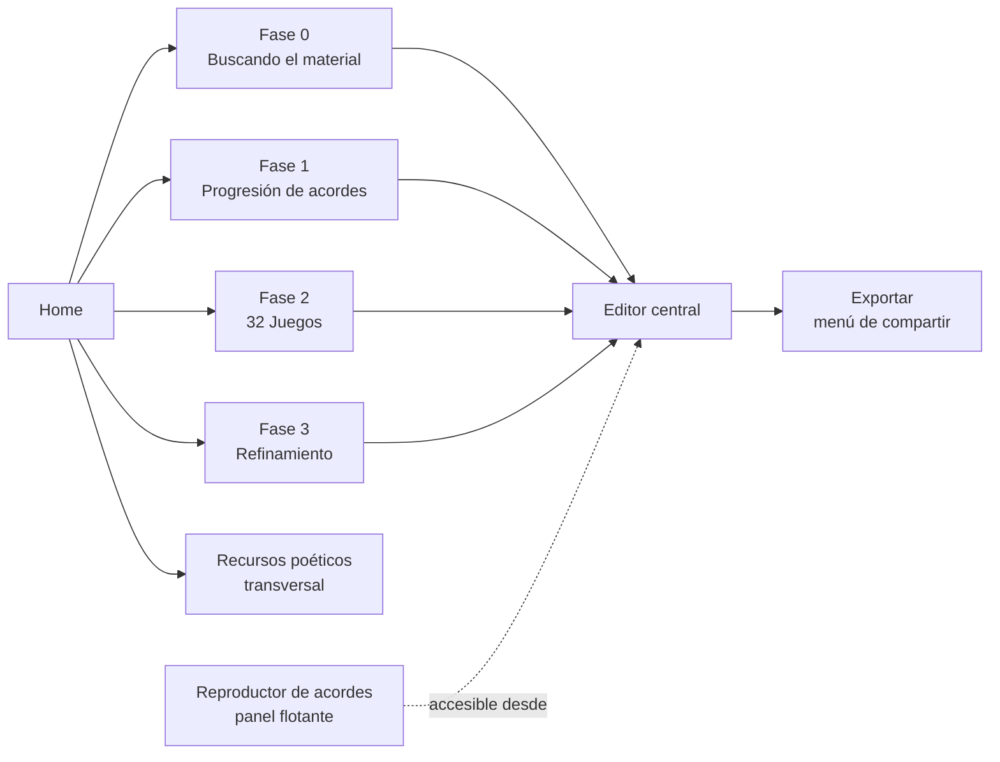

# Compositor de Canciones — Documentación de producto y desarrollo

> Nombre de trabajo: **Songwriting Games** (a definir).
> Plataformas: **iPhone primero**, Android después. Idioma: español argentino (es-AR).
> Este paquete **no contiene código**. Es la documentación de referencia para que OpenCode (modelos gratuitos como MiniMax y Big Pickle) implemente la app por etapas.

## 1. Cómo leer este paquete

| Si querés... | Leé |
|---|---|
| Entender qué se construye y por qué | `PRODUCT_SPEC.md` |
| Ver qué decisiones tomé y cuáles te tengo que consultar | `DECISIONS_AND_OPEN_QUESTIONS.md` **(leer primero)** |
| Saber con qué tecnología se hace | `TECHNICAL_ARCHITECTURE.md` |
| Saber qué se guarda, qué no, y cómo funciona lo offline | `PRIVACY_AND_OFFLINE.md` |
| Armar el banco de palabras | `LEXICAL_DATABASE_AND_APIS.md` |
| Las demás áreas | Ver tablero de progreso (sección 3) |

## 2. Convenciones de todos los documentos

- **Juego** (con mayúscula) = cada uno de los 32 métodos creativos de la Fase 2. Nunca se fusionan, eliminan ni cambian en esencia.
- **[ORIGINAL]** = texto o regla tomada literalmente del encargo del usuario.
- **[REC]** = recomendación mía donde el encargo no especifica. Incluye el porqué.
- **[VERIFICAR]** = dato externo que no pude confirmar con una fuente oficial. Verificar antes de implementar.
- **[BLOQUEANTE]** = decisión que el usuario debe tomar antes de que OpenCode avance en ese punto.
- Identificadores: `D-xx` decisiones, `R-xx` riesgos, `G-xx` Juegos (G-01 a G-32), `F0-x` ejercicios de Fase 0.
- Voz del texto: neutral/rioplatense. Los textos de interfaz de la app van en es-AR (voseo: «elegí», «tocá»).

## 3. Tablero de progreso

| # | Archivo | Tanda | Estado |
|---|---|---|---|
| 0 | `README.md` | 1 | Hecho |
| 0b | `DECISIONS_AND_OPEN_QUESTIONS.md` (extra) | 1 | Hecho |
| 2 | `PRODUCT_SPEC.md` | 1 | Hecho |
| 15 | `TECHNICAL_ARCHITECTURE.md` | 1 | Hecho |
| 13 | `PRIVACY_AND_OFFLINE.md` | 1 | Hecho |
| 11 | `LEXICAL_DATABASE_AND_APIS.md` | 1 | Hecho |
| 3 | `USER_FLOWS.md` | 2 | Hecho |
| 4 | `GAME_CATALOG.md` | 2 | Hecho |
| 5 | `GAME_ARCHITECTURE.md` | 2 | Hecho |
| 12 | `RANDOMIZATION_SYSTEM.md` | 2 | Hecho |
| 10 | `CONTENT_DATABASE.md` | 2 | Hecho |
| 6 | `MUSIC_ENGINE.md` | 3 | Hecho |
| 7 | `LYRIC_EDITOR_AND_EXPORT.md` | 3 | Hecho |
| 14 | `DESIGN_SYSTEM.md` | 3 | Hecho |
| 8 | `POETIC_STRUCTURES.md` (con tabla de revisión académica) | 4 | Hecho |
| 9 | `POETIC_RESOURCES.md` | 4 | Hecho |
| 16 | `IMPLEMENTATION_ROADMAP.md` | 5 | Hecho |
| 17 | `QA_AND_ACCEPTANCE_TESTS.md` | 5 | Hecho |
| 18 | `OPENCODE_INSTRUCTIONS.md` | 5 | Hecho |

Orden de las tandas: 1 fundamentos, 2 Juegos y datos, 3 música, editor y diseño, 4 poesía, 5 ejecución: **todas hechas**. Decisiones del usuario en `DECISIONS_AND_OPEN_QUESTIONS.md` (sección 0). Preguntas abiertas de poesía (P-1 a P-6) en `POETIC_STRUCTURES.md` §5.
Preguntas abiertas de poesía (P-1 a P-6) en `POETIC_STRUCTURES.md` §5.

## 4. Mapa general

## 5. Alcance de la versión 1

Incluye: Fase 0 (5 ejercicios), Fase 1, Fase 2 (32 Juegos), Fase 3, biblioteca de 29 recursos poéticos, editor central, exportación, banco léxico local, sistema de no repetición.
No incluye: IA generativa, cuentas, sincronización en la nube, panel de administración, suscripción activa (solo la preparación arquitectónica).
