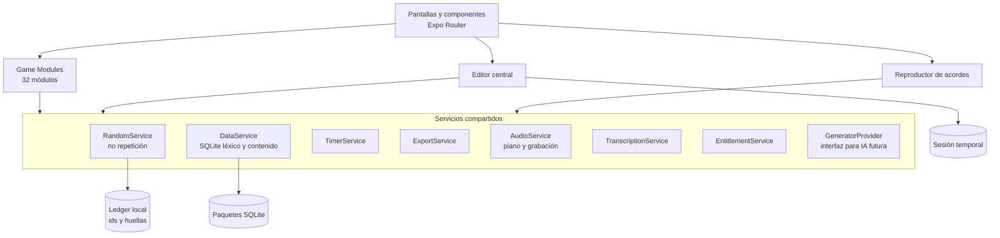

# TECHNICAL_ARCHITECTURE — Stack, arquitectura y decisiones

Convenciones: ver `README.md`. Estado de verificación de cada dato indicado con **[VERIFICAR]** cuando corresponde.

## 1. Restricciones que condicionan la tecnología

1. **iOS-first desarrollando desde Windows 10.** No hay Xcode local. Las compilaciones iOS deben hacerse en la nube (EAS Build) o en una Mac (ver D-01).
2. **Modelos de programación gratuitos (MiniMax, Big Pickle) en OpenCode:** conviene un ecosistema con mucha documentación pública, TypeScript tipado y módulos pequeños.
3. **Sin costos recurrentes** salvo los inevitables de tiendas (D-01).
4. **Módulos nativos necesarios:** audio de baja latencia, grabación, reconocimiento de voz on-device, gestos y lienzo gráfico.

## 2. Comparación React Native/Expo vs Flutter

| Criterio | React Native + Expo | Flutter |
|---|---|---|
| Desarrollo desde Windows con iOS | Posible con EAS Build (nube). Android local fluido | Mismo problema: compilar iOS exige macOS |
| Reconocimiento de voz on-device | Existe `expo-speech-recognition` (envuelve SFSpeechRecognizer en iOS y SpeechRecognizer en Android, con opción de exigir reconocimiento en el dispositivo) | Hay plugins de la comunidad; menos documentación en esta función |
| Audio de baja latencia / piano | Opciones: `expo-audio`, `react-native-audio-api` **[VERIFICAR]** | Paquetes de audio y MIDI disponibles **[VERIFICAR]** |
| Gestos y animaciones | Reanimated + Gesture Handler (maduros) | Nativo del framework, muy fluido |
| Lienzo del Mapa Mental | `@shopify/react-native-skia` | Canvas/`CustomPainter` nativo |
| SQLite local | `expo-sqlite` | `sqflite`/`drift` |
| Calidad de los modelos gratuitos en el código | Generalmente buena en TypeScript/React | Buena en Dart, menos ejemplos |
| Ecosistema JS para teoría musical y texto | Amplio (`tonal`, utilidades de texto) | Menor |
| Riesgo de actualización | SDKs frecuentes; la Nueva Arquitectura es obligatoria desde SDK 55 | Actualizaciones frecuentes, cambio más estable |

### Recomendación [REC]: **React Native + Expo (development builds) + TypeScript**
Razones: mayor cobertura de documentación y ejemplos para los modelos gratuitos, voz on-device ya resuelta por una librería activa, ecosistema JS para teoría musical, y el trabajo diario puede hacerse en Android desde Windows. Flutter es una alternativa válida pero no ofrece una ventaja decisiva para este caso.

**Importante:** Expo Go no sirve para este proyecto (módulos nativos propios). Se usan *development builds* desde el primer día.

### Versiones
- Verificar la SDK estable de Expo al iniciar y fijarla. Desde **SDK 55** la Nueva Arquitectura es obligatoria y la arquitectura antigua ya no existe; el changelog oficial de Expo ya menciona versiones posteriores (SDK 57). **Regla:** crear el proyecto con la SDK estable más reciente y instalar dependencias siempre con `npx expo install <paquete>` para que Expo elija versiones compatibles.
- No fijar versiones de librerías en este documento (cambian rápido). El roadmap indica que la Etapa 0 genere un `DEPENDENCIES.md` con las versiones realmente instaladas.

## 3. Stack propuesto

| Capa | Elección | Notas |
|---|---|---|
| Lenguaje | TypeScript estricto | `strict: true`, sin `any` implícito |
| Navegación | Expo Router | Rutas por archivo; modales para reproductor de acordes |
| Estado | Zustand | Un *store* por dominio (sesión, editor, reproductor, ledger) |
| Persistencia de datos de contenido | `expo-sqlite` | Paquetes SQLite versionados (léxico, contenido) |
| Persistencia ligera | Almacenamiento clave-valor local | Preferencias y ledger de no repetición |
| Animaciones/gestos | Reanimated + Gesture Handler | Deslizar izquierda/derecha, arrastre en Mapa Mental |
| Lienzo | React Native Skia | Mapa Mental, Collage textual, Cut-up |
| Audio/piano | Motor de muestras con programación precisa de tiempo **[VERIFICAR librería]** | Sesión de audio en modo reproducción |
| Grabación | `expo-audio` (grabación) **[VERIFICAR]** | Archivos en carpeta temporal |
| Voz a texto | `expo-speech-recognition` | Ver `PRIVACY_AND_OFFLINE.md` |
| Teoría musical | `tonal` **[VERIFICAR licencia y versión]** | Notas, acordes, escalas; el detector de tonalidad es propio |
| Compartir | API de compartir del sistema para texto; para archivos, librería de compartir archivos | Siempre con confirmación del usuario |
| Exportar imagen/PDF | Captura de vista y generación de PDF **[VERIFICAR librerías]** | Mapa Mental |
| Pruebas unitarias | Jest (`jest-expo`) | Lógica pura: no repetición, acordes, sílabas |
| Pruebas de interfaz | Maestro u otra herramienta de flujos **[VERIFICAR]** | Flujos críticos |

## 4. Arquitectura en capas



Reglas de dependencia:
1. Los **Game Modules** solo conocen servicios mediante interfaces; nunca se importan entre sí.
2. El **Editor central** no conoce ningún Juego. Los Juegos le envían «inserciones» y estímulos por una API (`EditorBridge`).
3. Toda aleatoriedad pasa por `RandomService`. Está prohibido usar `Math.random()` fuera de él.
4. Toda lectura de palabras o contenido pasa por `DataService`.

## 5. Estructura de carpetas

```
/app                      # rutas Expo Router
  (home)/ (fase0)/ (fase1)/ (fase2)/ (fase3)/ recursos/ editor/
/src
  /core                   # tipos, utilidades puras, constantes
  /services               # random, data, timer, export, audio, transcription, entitlement, generator
  /stores                 # zustand
  /design                 # tokens, componentes base, temas por Juego
  /editor                 # editor central y su API
  /music                  # acordes, tonalidad, progresiones, reproductor
  /poetry                 # estructuras, silabeo, recursos
  /games                  # un directorio por Juego + registry
    /registry.ts
    /g01-asociacion-libre/ ...
  /fase0                  # ejercicios
/assets                   # fuentes, muestras de piano, imágenes de UI
/data                     # fuentes de autoría (CSV/JSON) y esquemas
/scripts                  # pipelines de construcción de paquetes de datos
/docs                     # esta documentación
/tests
```

## 6. Game Registry
Cada Juego exporta un objeto `GameModule` y se registra en `registry.ts`. El contrato completo está en `GAME_ARCHITECTURE.md` (tanda 2). Agregar un Juego = crear su carpeta + una línea en el registro, sin tocar navegación ni servicios.

## 7. Datos
- **Paquetes SQLite** generados por scripts en `/scripts` a partir de fuentes de autoría. Se incluyen en la app o se descargan según tamaño (ver D-05).
- **Actualizaciones de datos sin cambiar código:** la app verifica un manifiesto versionado alojado como archivo estático (p. ej., en un hosting gratuito de archivos) y descarga paquetes nuevos. Opcional en v1 [REC].
- Esquemas y licencias en `LEXICAL_DATABASE_AND_APIS.md` y `CONTENT_DATABASE.md`.

## 8. Preparación para IA futura
- Interfaz `GeneratorProvider { suggest(request): Promise<Suggestion[]> }` con una implementación **local determinista** en v1 (usa SQLite y reglas).
- Una futura implementación remota hablaría con un **proxy propio** que guarda la clave; **la app nunca contiene claves de API**.
- Todos los Juegos piden estímulos por esa interfaz, de modo que el reemplazo no los toca.

## 9. Seguridad
- Sin cuentas ni credenciales en el cliente.
- Sin claves de API en el repositorio ni en el bundle. Variables sensibles futuras viven en el servidor proxy.
- Entradas de texto del usuario tratadas como datos: nunca se interpretan como código ni se registran.
- Los enlaces externos se abren con el navegador del sistema.

## 10. Configuración de entornos [REC]
| Entorno | Uso |
|---|---|
| `dev` | Desarrollo con *development build* en Android/emulador |
| `preview` | Build interna firmada para probar en iPhone (EAS) |
| `production` | Tiendas |

Comandos de referencia (a confirmar en la Etapa 0 contra la documentación vigente):
```
npx create-expo-app@latest
npx expo install <paquete>
npx expo run:android
eas build --profile preview --platform ios
```

## 11. Decisiones registradas

| ID | Decisión | Estado |
|---|---|---|
| T-01 | React Native + Expo + TypeScript | Propuesta [REC] |
| T-02 | *Development builds*, sin Expo Go | Propuesta [REC] |
| T-03 | Zustand para estado | Propuesta [REC] |
| T-04 | SQLite local para contenido | Propuesta [REC] |
| T-05 | Skia para lienzos | Propuesta [REC]; validar rendimiento en etapa del Mapa Mental |
| T-06 | Sin backend propio en v1 | Propuesta [REC] |
