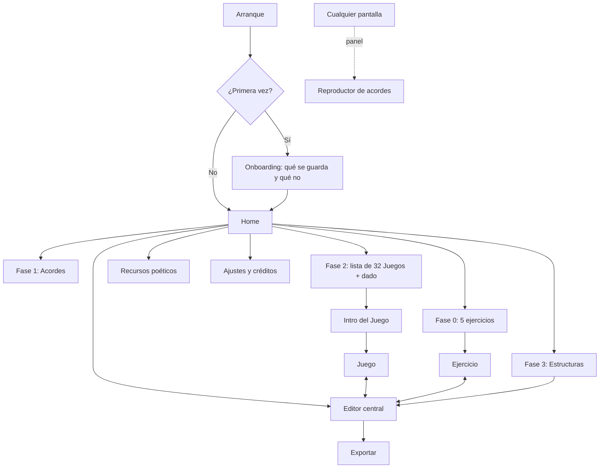
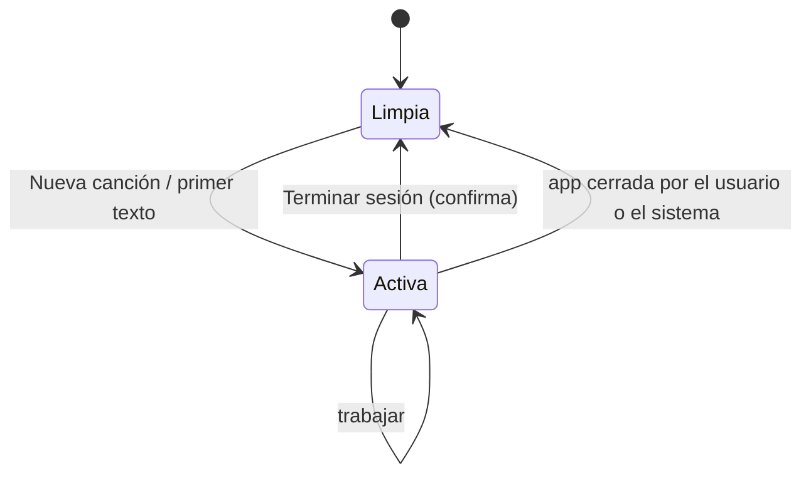
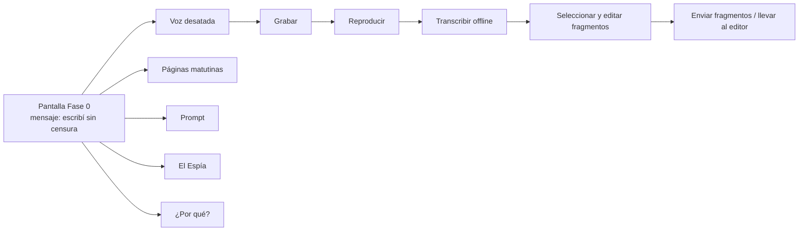
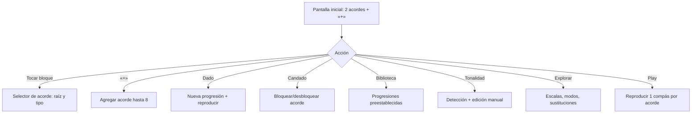
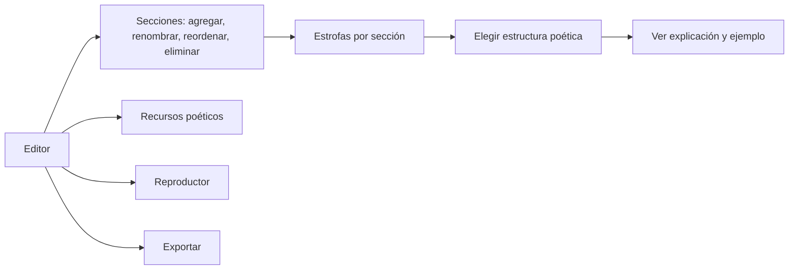
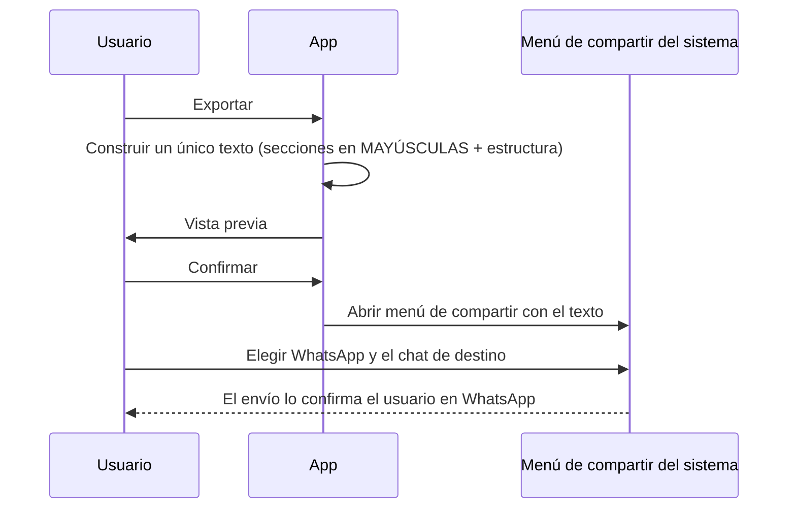

# USER_FLOWS — Flujos y navegación

Convenciones en `README.md`. Reglas de sesión según D-03 (sin recuperación). Detalle de cada Juego en `GAME_CATALOG.md`.

## 1. Mapa de navegación

**Navegación persistente:** barra inferior con cinco destinos: *Inicio*, *Material* (Fase 0), *Acordes* (Fase 1), *Juegos* (Fase 2), *Escribir* (editor). *Estructuras* (Fase 3) y *Recursos* son accesibles desde el editor y desde Inicio. Un botón flotante (nota musical) abre el reproductor desde cualquier pantalla.

## 2. Primera apertura (onboarding)
1. Pantalla 1: qué es la app (una frase y una ilustración).
2. Pantalla 2: **«Tu canción no se guarda»**: explica que nada se conserva al cerrar la app y que se puede exportar.
3. Pantalla 3: recorrido sugerido (Fase 0 → 1 → 2 → 3) con aclaración de que todo es opcional.
4. Sin registro ni permisos en este momento.
Se puede revisar luego desde Ajustes.

## 3. Home
- Tarjeta destacada: «Empezá con Fase 0 (recomendada)».
- Accesos a cada fase y a recursos poéticos.
- Botón «Nueva canción» / «Continuar» si hay sesión en memoria.
- Dado «Sorprendeme con un Juego».

## 4. Sesión

- «Terminar sesión» → diálogo: «Se borrará todo (letra, grabaciones, mapas). ¿Querés exportar antes?» con *Exportar*, *Borrar*, *Cancelar*.
- Salir de la app con contenido sin exportar: no hay forma de interceptar el cierre forzado del sistema; el aviso es **preventivo** (insignia «sin exportar» en el editor y aviso al ir a segundo plano si lleva > N minutos sin exportar [REC N=10]).

## 5. Fase 0 — Buscando el material

- Pantalla de entrada: texto motivador y la aclaración **[ORIGINAL]**: no importa que sea interesante, bonito, coherente ni útil.
- Los ejercicios son independientes entre sí y se pueden saltar.
- Voz desatada: permiso de micrófono solo al tocar «Grabar»; si se deniega → estado con acceso a Ajustes; si no hay reconocimiento offline → ver `PRIVACY_AND_OFFLINE.md` (alternativa manual).
- Prompt: pantalla con dos tarjetas (prompt e imagen); deslizar izquierda/derecha sobre cada una cambia solo ese estímulo; hay también «cambiar ambos».
- El Espía: preguntas guía → «Empezar» → cuenta regresiva de 60 s → escritura.
- ¿Por qué?: solo instrucciones + área de escritura; atajo para insertar «¿Por qué?».

## 6. Fase 1 — Acordes

Detalle de reglas en `MUSIC_ENGINE.md` (tanda 3).

## 7. Fase 2 — Juegos
1. Lista/galería de 32 Juegos (orden fijo 1–32) con identidad de cada uno + dado de Juego aleatorio.
2. Tocar un Juego → **Intro** (título, objetivo, paso a paso, ejemplos, «Comenzar»).
3. «Comenzar» → configuración (si aplica) → interfaz del Juego.
4. En el Juego, panel inferior **dock de escritura**: muestra el estímulo clave y permite abrir el editor central a pantalla completa. Volver restaura el estado del Juego.
5. Salir del Juego: vuelve a la lista; el estado queda en memoria durante la sesión.

## 8. Editor central

- Estructura por estrofa visible como etiqueta (p. ej. «Redondilla ABBA») con ayuda contextual.
- Los estímulos de los Juegos llegan solo por acción explícita («Llevar al editor»), nunca reemplazan texto.
- Teclado: el área de escritura sube con el teclado y el cursor siempre queda visible; el estímulo clave se puede minimizar.

## 9. Exportar

- La app **nunca envía mensajes por sí sola**.
- También exportan: fragmentos de Voz desatada y otros materiales de Fase 0; Mapa Mental como archivo propio, imagen o PDF.

## 10. Reproductor de acordes (panel)
- Se abre por encima del contenido actual (hoja deslizable) desde el botón flotante.
- No cambia la pantalla de fondo, el cursor del editor ni el estado del Juego.
- Controles: Play, Pausa, Loop, BPM, silenciar. Se cierra deslizando hacia abajo.

## 11. Estados transversales

| Situación | Comportamiento |
|---|---|
| Sin permisos de micrófono | Mensaje explicativo + botón a Ajustes del sistema + alternativa de escritura |
| Sin reconocimiento offline | Aviso claro + transcripción asistida manual |
| Sin conexión y enlace externo | «Necesitás conexión para abrir este enlace»; el Juego sigue funcionando |
| Imágenes de API sin conexión | Se usan solo las incluidas; aviso discreto |
| Pool agotado | Se reinicia el ciclo en silencio (sin errores visibles) |
| Banco de datos corrupto o faltante | Pantalla de error con «Reintentar» y «Reinstalar paquete» |
| Sesión vacía | Estado vacío ilustrado con CTA «Empezar» |
| Exportar con letra vacía | Aviso «No hay nada para exportar» |
| Eliminar sección/estrofa con texto | Confirmación |
| Mapa Mental sin guardar al salir | Pregunta: exportar archivo, descartar o seguir |

## 12. Accesibilidad en los flujos
- Todo gesto de deslizar tiene alternativa con botones («Anterior/Siguiente», «Cambiar»).
- Cuenta regresivas y temporizadores anuncian cambios a lectores de pantalla en hitos (no cada segundo).
- Animaciones reducidas si el sistema lo indica.
- Orden de foco lógico en cada pantalla; objetivos táctiles ≥ 44 pt.
